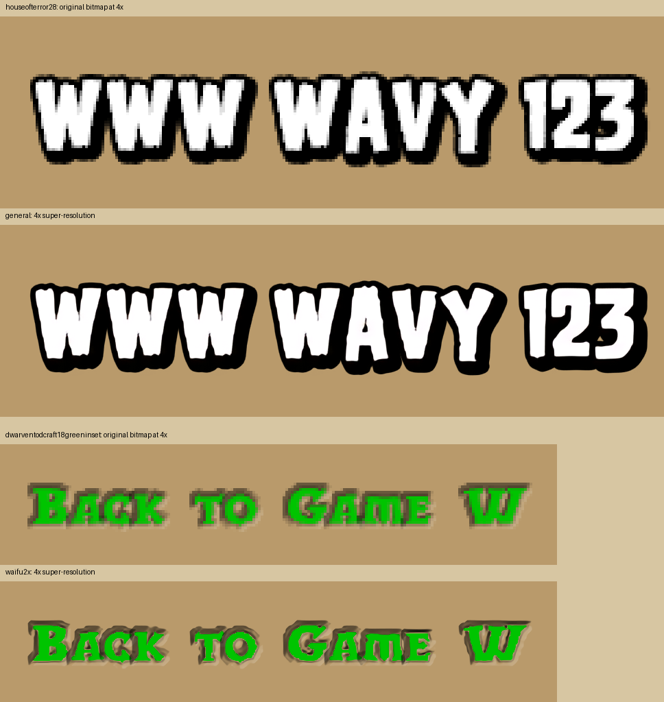

# 原版位图字体 4× 超分

输入是当前 `assets/resources/fonts` 中的原始 RGBA 位图。输出包含 18 套字体、20 张独立字图（共 21 个图层引用），以及每套字体的放大对照图。

`Pico129`、`Pix118Bold` 是刻意采用像素风格的字体，始终排除在超分处理之外，继续使用原图和最近邻采样。

字图和字体配置位于 `art/resource-packs/hd/fonts`，不参与 Cocos 资源导入；本目录保存对照图及来源记录。重新超分后运行 `npm run build:hd-pack` 生成 `dist/resource-packs/hd.zip`，在 Debug CLI 中执行 `/pack install` 选择 ZIP 安装。`/pack load hd` 仅重新启用已安装包，`/pack unload hd` 恢复原资源；原字图保留，像素字体不包含在 HD 包中。

字体加载入口按资源 ID 查询已启用的包，读取包内对应的字体配置和字图，完成后交给原渲染器。包中没有覆盖的 ID 使用原版资源；已声明的字体加载失败直接报告错误，不使用另一版本兜底。切换资源包时重新创建场景，保持原版度量和排版。



## 处理方式

- 普通字体和黑色描边字体使用 [Real-ESRGAN realesr-general-x4v3](https://github.com/xinntao/Real-ESRGAN)，直接进行 4× 神经网络超分。
- Dwarven 系列使用 [waifu2x upconv_7/art](https://github.com/nagadomi/waifu2x) 连续两次 2× 超分。先按原有的黑色、白色和可选主色拆分各自的覆盖范围，分别超分后合成 RGBA，避免黑底、白底预测的轮廓偏差产生杂边。每次 2× 推理对镜像和转置的八种结果取平均，减轻方向性毛刺。
- 黄色按钮字体已重新生成：拆分时将主色归一化，保证各层覆盖之和等于原 alpha，避免灰色分量重复计入导致细黑边和色偏；超分后的覆盖遮罩做 3×3 中值处理，去掉孤立毛刺，保留抗锯齿和阴影层次。原字体较大的石刻起伏保留。该处理已加入生成器，其他 Dwarven 字图在重新生成时采用。
- 其余单色字体超分 alpha 遮罩，保留原来的白色或黑色 RGB；其余彩色字体分别超分黑底、白底合成图，再恢复 RGBA。
- 字符分开留出推理边距，推理后重新排列图集；最终每张图不超过 4096×4096，字符之间留 4px 间隔。

JSON 保留原字号、基线、偏移、字距、kerning、绘制顺序和字形逻辑尺寸。只调整图集中的位置，并增加图层 `textureScale: 4`。`FontRenderer` 仅将纹理采样矩形乘此比例，布局尺寸仍用原值。超分纹理采用线性采样，原字体保留最近邻采样。Web 端加载高清字图后，通过解码后的 RGBA 像素缓冲上传一次，避免直接上传 HTML 图片时出现空纹理；完成后复用字体缓存。Mod 提供的字体继续使用自己的字图。

超分会估算原图缺少的像素，细小轮廓可能变化；各 `*-comparison.png` 上半部分是原图最近邻放大，下半部分是模型结果。可先查看：

- [黑色描边与 W](houseofterror28-comparison.png)
- [绿色按钮字](dwarventodcraft18greeninset-comparison.png)
- [小字号描边](houseofterror16-comparison.png)
- [正文](dwarventodcraft15-comparison.png)
- [Dwarven 边缘处理前后](dwarventodcraft-edges.png)
- [黄色按钮字边缘修正](dwarventodcraft18yellow-edges.png)

## 重新生成

依赖 Python、Pillow、NumPy、PyTorch。当前机器的环境可直接运行：

```sh
/opt/miniconda3/bin/python tools/upscale_fonts.py
```

指定字体或模型：

```sh
python tools/upscale_fonts.py --fonts houseofterror28 dwarventodcraft18greeninset
python tools/upscale_fonts.py --model waifu2x --fonts houseofterror28 --output temp/font-upscale/alternative
```

默认优先使用 MPS，其他机器使用 CPU，也可显式传入 `--device cuda`。权重按需从上面的官方仓库下载，缓存到忽略目录 `temp/font-upscale`。生成过程不需要浏览器。

`sources.json` 记录每套字体使用的模型、超分倍数及输入文件 SHA-256；Dwarven 条目还记录覆盖层处理及方向平均数量。已检查所有字体的布局数据和字形逻辑尺寸保持一致、图集尺寸和字符采样矩形未越界。模型代码许可见 [font-upscale.txt](../../../tools/licenses/font-upscale.txt)。
