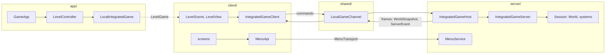

[简体中文](ARCHITECTURE.zh-CN.md)

# Architecture

The game's code is in `assets/scripts/`. A server runs the play, a client draws it and sends the player's commands, and both load the same content, the base game and the Mods, through code they share.

## Overview

The game is a client and a server in one process. The server runs the play; the client draws it and sends commands. Both load the same content (the base game's and the Mods'), so the rules both sides need live once, in `shared`.

### Directories

All game code is under `assets/scripts/`.

| Directory | Contents |
| --- | --- |
| `server/` | Authoritative play: the world's typed lists and systems, a fixed 0.01 s tick (100 ticks a second), deterministic RNG, server saves (strictly parsed), and the menu backend (`server/menu`). |
| `shared/` | The protocol, content formats and their validation, the channel, and the wrapper of the C++ kernel (`shared/kernel`). |
| `client/` | Views, input, audio and resource loading. It reads snapshots and events only, and changes play through commands. |
| `app/` | `GameApp` (the menu shell), `LevelController` (a level's lifecycle, saving and loading), `LocalIntegratedGame`, `LocalMenuApi`, the Mod loader and the save coordinator. |
| `core/` | The global clock `gameClock`, and the tweens that follow it. |
| `platform/` | Device and settings glue on the engine: haptics, the options (volume, full screen), the debug settings and the debug CLI commands. |

The main scene mounts `app/GameApp.ts`. It coordinates the menu shell and starts `LocalIntegratedGame` through `app/LevelController.ts`. Gameplay runs in `server`; the client consumes protocol snapshots and events.

### Import boundaries

`server` and `shared` import no engine code and run as they are in Node tests. `tests/architecture/import-boundaries.test.ts` enforces the boundaries:

| Directory | May not import |
| --- | --- |
| `server` | `app`, `client`, `platform`, `core`, the engine (`cc`) |
| `shared` | `app`, `client`, `server`, `platform`, `core`, the engine (`cc`) |
| `client` | `server`, `app` |
| `core` | `app`, `client`, `server`, `platform` (it stands on the engine alone) |

Keep engine imports out of `server` and `shared`.

### Main flows

- **Combat**: the client sends a `GameCommand` → `IntegratedGameHost` queues it on `IntegratedGameServer`, which checks it and runs the systems → the server answers with a `WorldSnapshot` and `ServerEvent`s → `LevelView`, its presenters and the entity views follow them.
- **Menus**: `screens → client/api/MenuApi → MenuTransport → server/menu/MenuService`. Pages never change a profile themselves.
- **Content**: the gameplay and presentation definitions are JSON under `mods/pvz-base/gameplay/` and `mods/pvz-base/presentation/`, split by category and packed into `assets/resources/base.zip`. The base content and every Mod use the same `manifest.json` / `content.json` and the same registries.
- **Mods**: a Mod comes in through `register({ host, assets })` and wraps host methods with `host.around()` / `host.replace()`; see [Mods](MODS.md).

### Design rules

- New content is data first (a zombie's `helm` and `shield` slots, for example).
- Generic renderers and systems never branch on a type ID. What only one kind does lives in that kind's class and view (`PlantViewRegistry`, `ZombieView` and the like).

## Protocol

### World snapshot

The `WorldSnapshot` (`shared/protocol/snapshot.ts`) names every field it carries, and `validateWorldSnapshot` checks them.

The base game's own state has fields of its own, each absent when the game has none:

| Field | Contents |
| --- | --- |
| `tools` | The game's tools: `owned`, and `available` now. |
| `conveyor` | The belt's `ticks`. |
| `dialog` | Dave's line `index`, and its Yes/No `question`. |
| `debug` | The debug rules, once a command has set one. |

`extensions` carries only two things:

- the Mods' registered data on entities (`entity.extensions`), by its ID;
- the level rule's `snapshot`, by the rule's kind, which the rule's client view parses.

Each entity class lists the fields it shows in its own `snapshot` method (`Plant.snapshot`, `Zombie.snapshot`, `Projectile.snapshot`, `Mower.snapshot`), with what only its kind shows in `snapshotOwn`; `server/session/snapshot.ts` assembles them and lists the items' fields itself. What the server adds to an entity therefore stays on the server until a snapshot names it.

### Local channel

The local channel (`shared/channel`) parses every client packet after a JSON round trip.

Server packets are handled by type:

- **Frames** are the most frequent packet, and the server builds each snapshot and event in them from new objects. A frame is therefore validated (`validateServerPacket`) and handed over without a copy.
- **Every other server packet** may reference server state. `copyServerPacket` checks its JSON safety and deep-copies it in one traversal, before the protocol's structure checks.

Nested Mod state, extensions and events are copied or checked the same way, so a client changing what it holds cannot reach the server or other snapshots. Client requests, external packet parsing and save formats keep their own rules.

### Ticks, frames and interpolation

`IntegratedGameHost` (`server/session/IntegratedGameHost.ts`) drives the server from the client's frame time:

- It accumulates the frame's seconds and runs a fixed tick (`TICK_SECONDS`, 0.01 s) for each whole tick they hold. An update that would need more than 1000 ticks stops the game with `tick-limit-exceeded`.
- When it catches up several ticks, it builds snapshots only for the last two ticks, a pause and a save point (the client renders once per update from the last two frames); it keeps every event.
- A `requestSave` is a barrier: packets after it wait until the save is made at a tick boundary with no command pending.
- `debugCommand` packets are accepted only when the host is created with debugging enabled.

Commands run in one of two places (`server/session/commands.ts`):

- **Session commands** (`pause`, `resume`, `completeIntro`, `syncPurse`, `advanceDialog`, `answerDialog`, `chooseSeed`, `confirmSeeds`, `finishRepick`, and debug commands) run between ticks at any time.
- **Player input** runs in the next tick's `command` phase, or between ticks when the client updates with a zero delta (`LevelInputPresenter` does this to confirm a tool selection before a touch move arrives).

A command that changes what is shown between ticks advances the session's `tick` but not its `gameplayTick`, so the client receives a frame of the same gameplay tick.

The client draws between the last two gameplay ticks (`ClientWorld.render`, by the host's `interpolationAlpha`):

- A frame of the same gameplay tick (input, or a pause) replaces the current snapshot but keeps the interpolation history (`ClientWorld.accept`).
- A pause keeps the host's part of a tick (its accumulator), so the picture stands where it is.
- On a loss and during a repick the client draws the last frame as it is, without interpolating.

## Server

### Layout

`server/` keeps no files at its root:

| Directory | Contents |
| --- | --- |
| `session/` | The game lifecycle: `IntegratedGameServer`, `IntegratedGameHost`, `session`, `commands`, `snapshot`, `persistence`, `save`, `savedLists`, `createModHost`, and the generated `hostModules`. |
| `state/` | The world (`World`, with `Entity`, `Position` and `EntityRemover`), the level's resources (`resources`), the event queue and the RNG. |
| `registry/` | The Mod registries: `GameplayRegistry`, `EntityExtensions`, and `kindFields` (the check of a kind's definition fields). |
| `level/` | Level flow: `level`, `levelAward`, `waves`, `conveyor`, `loot`, `sun`, and `lawn` for looking up what is on the lawn. |
| `rules/` | The level rules: `registry`, and the built-in `adventure`, `bowling` and `whackAZombie`. |
| `seeds/` | The seed bank, chooser, planting, cursor and tools. |
| `combat/` | Targets, explosions, collision, chill and freezing (`cold`, `freeze`, `ice`). |
| `projectiles/` | `Projectile`, `MowingProjectile`, `ProjectileRegistry`, `motions`, `projectiles`. |
| `mowers/` | The rows' lawn mowers: `Mower`, `mowers`. |
| `items/` | The items: `items`, `itemSpawn`. |
| `gridItems/` | The grid items: `gridItems`, `graves`, `craters`. |
| `achievements/` | The achievements and their triggers. |
| `plants/`, `zombies/`, `tutorials/`, `debug/`, `menu/` | Their own areas. |

The client keeps each kind of entity's views in a directory of the same name (`plants/`, `zombies/`, `projectiles/`, `mowers/`, `items/`, `gridItems/`).

Mods get every module by its path under `assets/scripts` (`host.get('server/state/resources')`), from the lists `npm run mod:hosts` (`tools/mod/hosts.ts`) generates. The server host gives the modules of `server` and `shared`; the client host those of `client`, `shared`, `platform` and `core`. `createModHost` adds the few values that are no module (`gameplay/registry`, `client/views`). A module that moves changes its ID.

Where the level's shared logic lives:

- `level/level.ts` initializes the shared level state and advances level progress.
- `state/resources.ts` defines the level, economy, seed bank, wave, tutorial and sky-sun state and their resources.
- Each kind of entity's type is in its own module: `items/items.ts`, `gridItems/graves.ts`, `gridItems/craters.ts`, and the classes `Plant`, `Zombie`, `Projectile` and `Mower`.
- `level/sun.ts`, `items/items.ts`, `level/waves.ts` and `zombies/groans.ts` provide the shared sky-sun, item, wave/award and zombie-groan logic. The progress, wave and groan systems' IDs are `pvz:level-progress`, `pvz:waves` and `pvz:zombie-groans`.

### World and entities

The world (`state/World.ts`) is typed lists, with no ECS components: `items`, `gridItems`, `plants`, `projectiles`, `mowers` and `zombies`, beside the world's `resources`. Each is an `EntityList` that holds the objects themselves by id and iterates them in id order.

An entity is its object in one of the lists:

- `createEntity` only allocates the id; ids are never reused.
- `insert` puts the object in, and `destroyEntity` takes it out.
- A system's `commands` (a `CommandBuffer`) defer both to the end of its phase. `commands.destroyEntity` hides the entity from every list at once (`markDestroy`).

### Session and schedule

A game is a `Session` (`session/session.ts`): the world, the clock (`tick`, `gameplayTick`), the command queue and the game's content definitions.

- `createSession` lays out the tick's phases and the systems' order; `startSession` starts a new game.
- `IntegratedGameServer` only schedules: it starts or restores a game, queues commands, advances ticks and puts out snapshots and events.
- The achievements see every event as it is emitted (`observeAchievements`); the gameplay only reports what happens.

Each phase runs its systems in order and then flushes its command buffer:

| Phase | Systems |
| --- | --- |
| `command` | `pvz:commands` (queued player input) |
| `tutorial` | `pvz:level-progress` |
| `spawn` | `pvz:waves`, `pvz:board-ice`, `pvz:craters`; then the level rule's systems (`LevelRuleDefinition.systems`), which may also go in later phases, after the wave system |
| `plant` | `pvz:plant-chill`, `pvz:plant-attacks`, `pvz:plant-production`, `pvz:plant-abilities`, `pvz:conveyor`, `pvz:plant-rolls`, `pvz:plant-animation` |
| `zombie` | `pvz:zombie-groans`, `pvz:zombie-lifecycle` |
| `mower` | `pvz:mower` |
| `projectile` | `pvz:projectile` |
| `item` | `pvz:items` |

During an intro the server runs no gameplay ticks and waits for `completeIntro`. Only a tutorial with `plantsLiveInIntro` (Wall-nut Bowling's) runs its plants' animation through the intro.

### Player rules

The rules of what a player does are split by what they are of:

| Module | Rules |
| --- | --- |
| `seeds/planting.ts` | What may be chosen, choosing, planting, making a plant, placing a zombie seed's zombie, finding the plant in a cell |
| `seeds/tools.ts` | The shovel and other tools |
| `items/items.ts` | Collecting sun, coins and the level award |
| `session/commands.ts` | Dispatching each command, and which commands run between ticks |
| `session/snapshot.ts` | Building the `WorldSnapshot` |
| `session/persistence.ts` | The world to a save and back; the save's format and checks are in `session/save.ts` |

Each rule function takes the `Session` first. The rules call each other through the objects their modules export (`planting`, `tools`, `items`, `commands`, `snapshot`), so a Mod that wraps one of those objects' methods with `host.around` reaches the host's own calls too.

### Combat

Combat is organized by what it is of. Modules import what they depend on directly, with no shared forwarding module.

Plants (`server/plants/`):

- Each plant is an instance of its kind's class, chosen by its gameplay definition's `kind` (`PlantRegistry`; see [Plants](#plants)).
- `attacks.ts` runs the plants' attacks (each plant's kind's `attack`; a shooter's is in `Shooter.ts`).
- `production.ts` runs their production, `abilities.ts` their special abilities (`act`), `rolls.ts` a bowled nut's roll (`roll`).
- `damage.ts` handles a plant eaten or struck down, and its death explosion.

Zombies (`server/zombies/`):

- `system.ts` runs each zombie's tick (`Zombie::Update`).
- `animation.ts` works out the ground track and animation time.
- `damage.ts` handles damage and death.
- `Zombie.ts` is the zombie class. `FlagZombie.ts`, `PoleVaulter.ts`, `Newspaper.ts` and `Dancer.ts` extend it, and `ZombieRegistry.ts` picks one by the definition's `kind`.
- `spawn.ts` has the spawning rules every zombie shares.

Elsewhere: `projectiles/projectiles.ts` runs the projectiles, `combat/explosions.ts` area blasts, and `combat/collision.ts` only provides geometry.

`GameplayRegistry` keeps only what Mods may register: the plant, zombie and projectile kinds, Mods' data on entities (`extensions`), level rules, achievement trigger types, projectile motions and tutorials.

### Lawn mowers

A row's lawn mower (the original's `LawnMower`) waits at its row's end until it sets off.

- **Waiting**: `startSession` creates one per active row (`Board::InitLawnMowers`; `createMower` in `mowers/mowers.ts`) at `MOWER_READY_X`. It is a `Mower` of the world's `mowers` (`mowers/Mower.ts`), its `typeId` the level's `lawnMower`.
- **Setting off**: a zombie reaching it makes `Mower.setOff` (`LawnMower::StartMower`) take it off its row and launch a projectile of that type where it waited. That is a `MowingProjectile` (`projectiles/MowingProjectile.ts`, the projectile kind `mowing`) on an entity of its own.
- **Running**: the projectile system moves it after the other projectiles (`Board::UpdateGameObjects` updates the lawn mowers last). It flattens zombies and plants and slows as it chews (`chompCounter`).
- **Flattened plants**: a plant it flattens stays in the world's `plants` with the `state` `mowered` until its squash has played. It is out of play, and `plantsInPlay` in `level/lawn.ts` passes over it.

The two are not one class: a waiting mower is no projectile, and a running one no mower.

Other rules:

- Once the level is won, each waiting mower, the lowest row first, turns into a gold coin where it waits every 40 ticks and is gone (`updateMowerCoins` in `level/loot.ts`, `Board::UpdateLevelEndSequence`).
- 2-1's savings cap counts the mowers waiting and running (`lawnMowerCount` in `level/lawn.ts`, `mLawnMowers.mSize`).
- `/lawnmower reset` puts a new one in a row without one waiting.
- Nothing installed squishes a mower (`MOWER_SQUISHED`).

The intro's roll-in is presentation only. The original's `MOWER_ROLLING_IN` is only for bonus mowers (`mBonusLawnMowersRemaining`); the intro's mowers are `MOWER_READY`, placed by `CutScene::UpdateIntro` from the cutscene's own time. Here the intro's time is the client's, so the roll-in is the mower view's drawing of the entity by that time (see [Projectile, mower, grid item and item views](#projectile-mower-grid-item-and-item-views)) and no server state.

In the protocol and saves:

- The snapshot's `mowers` lists the waiting mowers (`MowerSnapshot`); a running one is among the `projectiles`.
- A save keeps a waiting mower in its `mowers` (`{id, position, typeId}`) and a running one in its `projectiles`, with its `chompCounter`.

### Projectiles

Projectiles have kinds as plants and zombies do. A projectile definition's `kind` (`projectile` when omitted) is its server class (`ProjectileRegistry` in `projectiles/ProjectileRegistry.ts`), and the presentation's `view` of the same name its client view.

- Each projectile is an object of the world's `projectiles`, its entity, with its `id` and `position` (saved as its fields).
- `launchProjectile` (`projectiles/Projectile.ts`) makes one of its type's kind and starts its motion (`Projectile.launch`).
- A `Projectile` takes its `damage` off what of the other side it hits (`canHit`, `strike`; a melon's splash too). A `MowingProjectile` crushes it.
- How either flies is its motion's (`motions.ts`).

The content check (`ProjectileRegistry.validate`) requires that:

- each type carries exactly the fields its kind takes (a `projectile` its `damage`, a `mowing` one none);
- a plant's `shooter.projectile` overrides none of the fields its projectile's kind lacks;
- each level's `lawnMower` is of a kind that mows.

### Saves

A level save is one game save holding the server's and the client's parts. Every format is parsed strictly, and older versions are refused.

| Save | Module | `schemaVersion` | Contents |
| --- | --- | --- | --- |
| Game save | `app/SaveCoordinator.ts` | 2 | The profile, the level, the content set (base and Mods), the server save and the client presentation |
| Server save | `server/session/save.ts` | 5 | The level ID and board seed, the enabled Mods, the clock, the entity allocator, the RNG, the level, economy, seed bank, tutorial, sky-sun, wave and event-queue state, achievement progress, and one array per typed list |
| Client presentation | `client/game/ClientPresentationSnapshot.ts` | 3 | The client's last two snapshots (which have `mowers`) and the level presentation |
| Level presentation | `client/level/LevelPresentationSnapshot.ts` | 5 | The flow, intro, end, advice, HUD and audio state, the views' entries, the hit `flashes`, the particles and the Mods' `extensions` |

In the server save, each list entry is the object's fields with its `id`, its `position` (none for a grid item) and its Mods' `extensions`. Ids are unique across the lists and below `allocator.nextEntity`, and `session/savedLists.ts` parses and checks each list's entries.

## Levels, rules and tutorials

### Levels

Ordinary levels configure rows, starting sun, seeds, waves and awards in `mods/pvz-base/gameplay/levels.json`; they need no numbered server files. Adventure 1-1 through 2-10 is installed.

Waves are either listed or built by a level rule; a level has one or the other:

- listed: `waves: [{ zombies, flagWave?, points? }]`, as `mods/example` does;
- built by a registered level rule: `rules: { kind, count, ...settings }`.

The wave plan is drafted when the game starts and saved with it.

### Tutorial scripts

Tutorial scripts are registered by ID in `GameplayRegistry.tutorials` (`server/tutorials/index.ts`):

- the base game's through `installBuiltinTutorials`;
- a Mod's through `registry.tutorials.register(ownerId, id, script)`.

A level's `tutorial` names one, checked when the content is validated. The running game looks it up from the world: `levelTutorial` gives the level's script, and `getActiveTutorial` gives it when it plays (on a first adventure, or always for one that is `alwaysActive`). The game routes its callbacks through it: seed selection, cancellation, planting, cooldown completion, sun and money collection, tool selection, plant removal and the dialogue.

- A level without a script leaves `tutorial` out and uses the shared flow.
- A base script's steps are `TUTORIAL_STEPS`; a Mod's are in its namespace.
- `plantingTutorial.ts` and `sunflowerTutorial.ts` contain only their special guides.
- Special tutorials register a script without adding level branches to the main server.

Flow that belongs to one level lives in that level's script under `server/tutorials`, and the level's `tutorial` only names the script. This covers Dave's dialogue, the shovel lesson's starting plants, 2-1's first coin and savings cap, chooser warnings and the seed-slot offer.

Script fields that shape the level:

| Field | Effect |
| --- | --- |
| `dave` | Brings Crazy Dave for the intro's dialogue. |
| `dialogQuestion` | Marks the current line as a Yes/No question, which the client answers with `answerDialog`. |
| `blocksIntro` | Keeps the intro from ending. |
| `blocksStart` | Keeps the zombies from coming. Independent of `blocksIntro`. |

### Tools

Tools are the gameplay `tools` table, by ID. Each has the `kind` that says what it does: with `shovel`, `tools.use` digs up the cell's plant, which the client lights under the pointer.

- A level's `tools` and a `tool` award must name one, and each needs its presentation `tools` look.
- Tools come from awards: a tool award records the tool in the profile when the level is won, and from then on every level has it. A level's own `tools` replace the awarded ones.

The shovel is a `UIButton` with the same touch flow as a packet: press to pick it up, drag to aim, release to use it, drag back onto its button to cancel. Tutorials allow it, and a pause ends the gesture.

### Selection

The server's `SeedBankState.selection` is one of four exclusive states: nothing, a bank packet, a conveyor packet or a tool.

- A conveyor selection keeps only the packet's ID; `selectedSeedId` in `server/seeds/seedBank` finds its seed.
- Saves keep the same shape. The older format with side-by-side fields is incompatible.

### Conveyor belt

A level's gameplay `conveyor` gives the belt: its `capacity`, `spacing`, movement period (`moveTicks`), supply weights (`seeds`) and its spawn intervals by how many packets it holds (`spawnDelay`, by `minPackets`). The presentation's `conveyor`, `tools` and `dave` tables hold the layouts, animation assets, rates and the dialogue's presentation settings.

### Planting line and planting decisions

A level's `plantingLine: {column}` is its red line (Wall-nut Bowling's): the player plants nothing right of that column, and gets `ADVICE_NOT_PASSED_LINE` the first time. It is a check of the shared planting decision below. The level presentation's `plantingLine` (`{sprite, offset, dialogs}`) draws it in play and during the listed Dave lines. Any level can have one, with or without a rule.

Where a seed may go is one decision for both sides: `plantingRefusal` in `shared/content/planting.ts` (`Board::CanPlantAt`). It reads a `PlantingLawn` that each side builds from its own state: the server from its World, the client from its snapshot (`snapshotLawn`).

- The server answers each refusal with its rejection and advice.
- The planting preview only shows whether there is one.

The cell rules under it are shared the same way:

- `holdsCell`: a rolling nut and a plant a mower is crushing hold no cell;
- `canShovel`: the shovel and its highlight;
- `graveAt` (`shared/content/graves.ts`).

### Level rules

Besides the waves, a level rule (`LevelRuleDefinition` in `server/rules/registry.ts`) may change the play where the original's Board calls into Challenge. The generic code only calls these hooks and never checks a level or rule ID.

| Member | Purpose |
| --- | --- |
| `validate`, `draft` | Check the rule's settings; draft the waves before the random picks (required). |
| `systems` | Systems the level adds to the schedule, after the wave system in their phase. |
| `spawnsZombies` | The rule raises the zombies itself and the wave system stands by. |
| `initialize` | `Board::InitLevel` and `Challenge::StartLevel`, before the level's script. |
| `boardClick` | A click on the board that hit nothing else (`Challenge::MouseDown`). |
| `cursorCleared` | After the cursor empties (`Challenge::ClearCursor`). |
| `dropsRefusedSeeds` | A seed that cannot go where it is placed is dropped instead of staying in hand. |
| `canPlantAt` | The rule's share of `Board::CanPlantAt`. |
| `dropLoot` | Takes over a loot drop after the roll. |
| `holdsAward` | Keeps the level award from dropping yet. |
| `parseState`, `snapshot` | Check the saved `wave.ruleState`; show the client its state under `extensions[kind]`. |

A rule's `canPlantAt(lawn, seed, row, column)` is the `LevelPlantingRule` of `shared/content/planting.ts`, asked for plant seeds before the planting line. The rule writes it once and gives the same function to its client view (`LevelRuleView` extends it), which the planting preview asks.

A rule keeps its state in `wave.ruleState` (checked by `parseState`) and shows the client `extensions[kind]`, which its client view parses. The client side is a view in `client/level/rules/` (`registerLevelRuleView`), with its settings in `presentation/definitions/rules.json`.

Mods add a kind with `GameplayRegistry.levelRules.register(owner, kind, { validate, draft, ...hooks })`.

### Built-in rules

| Rule | Behaviour |
| --- | --- |
| `pvz:adventure` | `Board::PickZombieWaves` for a first adventure (below). |
| `pvz:bowling` | The adventure waves at four times the points, and no money. |
| `pvz:whack-a-zombie` | Raises its own zombies and counts its own waves. |

`pvz:adventure` builds:

- wave points, and flag waves with their normal and flag zombies;
- an optional `pointsScale` (3 on 1-10);
- `fixedZombies` placed before the random picks (the zombie a level introduces, in wave count/2+1 and the final wave);
- a final wave that gets each weighted `zombiePool` type it still lacks, in pool order (`PutInMissingZombies`).

A flag wave brings on the zombie the gameplay settings' `flagWave.zombie` names (the flag zombie, `ZOMBIE_FLAG`) after up to `maxPlain` (8) of its `plain` zombies (the normal zombie, which every adventure level's pool must have; `Board::PickZombieWaves`). The street before an adventure level leaves that zombie out (`CutScene::PlaceStreetZombies`).

The rule checks its own settings. `zombiePool` entries are zombie IDs, which take `points`, `weight` and `firstWave` from the zombie's `wave`, or objects that override them.

### Wave announcements

Waves are announced by `nextWaveComing` in `server/level/waves.ts` (`Board::NextWaveComing`):

- The wave system calls it 5 ticks before a wave, and as a huge wave's countdown ends.
- A rule that raises its own zombies calls it from its own countdown of the waves' `nextWaveAtTick`.
- It shows the final wave's banner before the last wave and sounds the awooga before the first; otherwise the siren where its caller says (a flag wave).
- `wave.announcedWave` keeps it to once a wave across saves.
- The client sounds it in `LevelAudioPresenter` (the `nextWaveComing` event).

A huge wave's message is the level's advice (`AdviceWidget`, style `huge-wave`, as `MessageWidget` has `MESSAGE_STYLE_HUGE_WAVE`). It comes and goes by the original's TextFadeOn (`pvz:textfadeon_enter`, `pvz:textfadeon_leave`), and advice given while it is up waits for it to leave (`MessageWidget::SetLabel`, `ClearLabel`).

## Content definitions

### Files and packing

Gameplay authoring tables live under `mods/pvz-base/gameplay/definitions/`, split into plants, zombies, seeds, boards, projectiles, items, achievements, tools, the store, its pages and the almanac. `gameplay/settings.json` contains the global defaults, and `gameplay/levels.json` the levels.

Presentation tables live under `mods/pvz-base/presentation/definitions/`, split into category files: plant and zombie animations, seed packet pictures, view selection, part tracks, shadows, dropped images, boards, levels, the store and more.

The root `mods/pvz-base/content.json` indexes every table, in the same format as Mod sources. Packing (`npm run mod:pack`, `tools/mod/cli.ts`) merges them into the package's `assets/gameplay.json` and `assets/presentation.json`, using the same structure as Mod packages and adding no resource requests. The base package is published to `assets/resources/base.zip` (`npm run mod:pack -- pvz-base --publish assets/resources/base.zip`, which `npm run build:content` also runs). Headless tools and tests read the same source tables (`tools/mod/content.ts`).

The types and parsers are in `shared/content`: `presentation.ts` for the presentation, and `gameplay.ts`, which gathers the gameplay ones (`gameplayTypes`, `parseGameplay`, `levelHelpers`, `seedGroups`).

Plant and zombie values match the original.

### Loading and validation

Gameplay and presentation configuration use `GameplayDefinitions` and `PresentationDefinitions`. Both are loaded, validated, returned as objects and injected into their consumers.

- Both parsers accept only each object's own fields (`exact` / `fields` in `shared/validate.ts`), and return only what they read and checked, with one shared copy of the point, pair and range readers.
- `ClientAnimationRegistry` starts from the parsed presentation definitions, only fills in what a clip leaves out (a zero offset, `rateScale` 1) and freezes the clips. A clip's fields are checked as the presentation is read (`parsePresentationDefinitions`).
- `loadIntegratedGameContent` returns `definitions` and `presentation`; UI owns its definitions through `UIAssets.presentation`.
- Animation registries, entity views and seed packets receive their definitions explicitly rather than consulting global configuration state.

### Registration and changes

`shared/content/DefinitionRegistry` registers base and Mod JSON through the generic `Registry`, validates references after registration, then freezes the result.

- Server entries register gameplay tables and levels. A Mod's entries in its own namespace are registered as new; its entries under other namespaces' IDs, and the settings outside the tables it writes, are JSON merge patches on what the base and the Mods loaded before it define. The Mods are taken in load order, and the result is checked.
- Client entries register presentation tables and names the same way.
- `PlantViewRegistry` creates built-in and Mod views from the same registry.
- UI and levels consume the same Mod presentation definitions, including new animation targets.

See [Mod Lab](../mods/example/README.md) and the [registration API](MODS.md#developing-and-packing).

### Plants

Each plant is of a kind, the server's class of it, chosen by its gameplay definition's `kind` (`plant` when omitted) as its view is by its presentation's `view`. The kinds are registered in `PlantRegistry` (`GameplayRegistry.plants`):

| `kind` | Server class | Base plants |
| --- | --- | --- |
| `plant` | `Plant` | Lily Pad |
| `shooter` | `Shooter` | Peashooter, Repeater, Snow Pea, Puff-shroom, Fume-shroom |
| `scaredyshroom` | `ScaredyShroom` (extends `Shooter`) | Scaredy-shroom |
| `producer` | `Producer` | Sunflower |
| `sunshroom` | `SunShroom` (extends `Producer`) | Sun-shroom |
| `fuse` | `FusePlant` | Cherry Bomb, Ice-shroom, Doom-shroom |
| `potatomine` | `PotatoMine` | Potato Mine |
| `chomper` | `Chomper` | Chomper |
| `gravebuster` | `GraveBuster` | Grave Buster |
| `hypnoshroom` | `HypnoShroom` | Hypno-shroom |
| `wallnut` | `WallNut` | Wall-nut, Explode-o-nut |
| `bowlingnut` | `BowlingNut` | Wall-nut Bowling's nuts |

A type has exactly the definition fields its kind takes and none another kind takes (`checkKindFields`), so a plant has at most one attack or ability:

| Field | Behaviour |
| --- | --- |
| `shooter` | Attacks on a rhythm. `shooter.type` is `shooter` (straight along its row), `lobber` (thrown) or `seeker` (homing). |
| `fright` | With a `shooter`, it hides (the Scaredy-shroom). |
| `producer` | Produces items (the Sunflower). With `growth` it grows, as the Sun-shroom does. |
| `fuse` | Goes off after its fuse: the Cherry Bomb's 3x3 burn after 100 ticks; with `freeze` in place of `explosion`, the Ice-shroom. |
| `mine` | The Potato Mine: up after 1500 ticks, risen in 106, an 1800 blast that leaves no body. |
| `chomper` | The Chomper: a 70-tick bite, then 4000 ticks digesting. |
| `graveBuster` | The Grave Buster. |
| `mindControl` | An awake Hypno-shroom brings the zombie or plant that eats it over to its side. |
| `bowling` | A bowled nut's roll. |

A plant with none of these only blocks (the Wall-nut). `deathExplosion`, which any kind may have, makes the Explode-o-nut go off when it is eaten or struck down.

The `pvz:plant-abilities` system in `server/plants/abilities.ts` steps each plant's own behaviour through its kind (`Plant.act`). The clips each state plays, the blinks and the Potato Mine's light are the plant's animation, which the server steps by `shared/content/plantAnimation`. The views under `client/plants` draw it from the snapshot, and `WallNutView` adds the nut's cracks.

### Animation definitions

A zombie's `animation` is written like a plant's:

- `clips`: frames, `fps` (a rate or `[min, max]`), `start`, `hold`, plus `ground` for a clip it walks on and `marks` for its bites and its fall;
- `layers`: which clip each layer plays (`{body: walk}`).

`ground` is the Reanim's `_ground` x, counted the way the walker faces: a zombie's as the Reanim has it, a plant's negated (its Reanim faces right).

- A zombie's walk has no `fps`; its speed paces it.
- A plant's clip may have both, as the bowled nut's roll (`wallnut_roll`) does. The nut rolls on it by the same `groundStep` (`Reanimation::GetTrackVelocity`) a zombie walks by.
- `from` inside it (`"animation": {"from": "pvz:normal"}`) starts it as another definition's of the same table, and what it writes beside `from` adds to that.

The presentation's `clips` hold the pictures of the same clip names (`walk`, `eat`, `death`...) and take `from` the same way (`shared/content/from.ts`). Snapshots carry `animations` per layer for both plants and zombies, stepped by `shared/content/animation`.

### Zombies

Zombie definition fields:

- `tongueChance` and `walk2Chance` select variants.
- A plant ability's `targeting` configures reach and the key zombies know it by (`insetKey`): the inset their `targetingInsets` give it, and whether their own mechanic passes it over.
- Post-vault attacks use `vault.landedAttack`.

Every zombie has the same states (`shared/content/zombieStates.ts`: `walking`, `eating`, `airborne`, `dying`, `burned`, `mowered`), whatever its kind. One in the air is `airborne`: out of reach of the lawn (no ground weapon targets it, a mower puffs it, fire removes it, it casts no shadow), and taken into and out of it by its own mechanic alone (the pole vaulter's jump; the original's in-air phases).

Each zombie is of a kind, the server's class of it, chosen by its gameplay definition's `kind` (`zombie` when omitted) as its view is by its presentation's `view`, one class to each view class. The classes are in `server/zombies/` and registered in `ZombieRegistry` (`GameplayRegistry.zombies`):

| `kind` | Server class | Client view | Own definition field | Own saved fields | Own snapshot (`own`) |
| --- | --- | --- | --- | --- | --- |
| `zombie` | `Zombie` | `ZombieView` | — | — | — |
| `flag` | `FlagZombie` | `FlagZombieView` | — | — | — |
| `polevaulter` | `PoleVaulter` | `PoleVaulterView` | `vault` | `hasPole` | `hasPole` |
| `dancer` | `Dancer` | `DancerView` | `dance` | `phase`, `phaseTicks`, `age`, `troupe`, `summonTicks`, `leader` | `phase`, `age` |
| `newspaper` | `Newspaper` | `NewspaperView` | `enrage` | `gaspTicks` | `enraged` |

A kind's own definition fields go with it: a type has those its kind takes and none another's, checked as the content loads.

Each zombie is an instance of its kind, an object of the world's `zombies` with its `id` and `position` (made by `ZombieFactoryResource`):

- Its fields are all there is to it: every zombie's (`ZombieFields`) and its kind's own. They are plain data alone (another zombie is referenced by its entity ID), and its save keeps them as they are.
- It is restored as its kind, which takes its own fields from the save and rejects any other (`Zombie.restore`, `restoreOwn`; the saved list's `restore`).
- Its type's definition is no field of it.

The rest of the game asks the zombie what only its kind knows, knowing no kind:

| Question | Methods | Examples |
| --- | --- | --- |
| How it comes on and sets off walking | constructor, `start`, `pickSpeed`, `setOffClip`, `walkAgain` | A pole vaulter runs holding its pole; an enraged newspaper zombie walks on its own walk. |
| What it does of its own each tick | `beforeTick`, `count`, `pauses`, `act` | A dancer's troupe's pace, its age and its dance; a newspaper zombie's gasp; a pole vaulter's vault. |
| Whether and with what it eats | `eats`, `attackRect`, `passesPlant` | |
| How it stops eating, walks and walks into the house | `stopEating`, `walks`, `intoHouse` | |
| What it lets go of as it loses its head, falls or is mowed | `dropCarried` | The flag zombie's flag, its `flag` layer (`Zombie::DropFlag`). |
| What losing its shield and being mind-controlled do to it | `shieldDropped`, `changedSides` | |
| What plants can do to it | `dodgesBite` (`Plant::UpdateChomper`), `evades` (by a targeting's key, `Plant::FindTargetZombie`) | A pole vaulter holding its pole slips from a chomper's bite unless it stands frozen, and is passed over by the targetings its `vault.evades` lists (the potato mine's `pvz:mine`). |
| What it shows and saves of its own | `snapshot`, `validSaved` | |

What only its kind shows the client goes in its snapshot's `own` (`snapshotOwn`). The shared snapshot checks it only as an object, and the kind's view reads and checks it (`ZombieView.own`). The shared protocol therefore names no kind's fields: each server class and its client view class share them.

A Mod's kind extends one of these classes and is registered by the name its definitions' `kind` give. The mine's client distance calculation reads the gameplay attack and body rectangles.

### Presentation tables

- Presentation `projectiles`, and a zombie's `helm`, `shield` and `drops`, define sprites, tracks, effects, offsets and sounds.
- A sound's `pitchRange` controls pitch randomization; negative ranges lower the pitch, as the newspaper rip's -2 does.
- An armor's `dropSounds` play with its `clips.drop` when it breaks, unless the hit bypasses the shield.
- `seedPackets` holds the packet flash effect (`flash`), the selection color and the default placement of a picture in its packet. A plant's own presentation `packet` may give its picture's `placement` and `phase`.
- `almanac` holds, by plant or zombie ID, the ground the almanac shows it on and whether its packet is an upgrade's.
- Presentation `boards` define backgrounds, music and game-over geometry; gameplay `boards.*.bounds` define the horizontal limits.
- A zombie whose animation has a `flag` layer carries a flag, dropped as in `Zombie::DropFlag`.
- Particle snapshots retain optional remaining lifetimes. Packet flashes use `seedPackets.flash`, with no effect-ID branches on restore.

The store is split the same way:

- The gameplay `store` table owns the shop's items by ID (the key of their count in the profile): each one's page and place (`page`, `place` 0-7), price or price tiers, Dave's line or lines, requirements, inventory rule and purchase effect.
- `storePages` lists the pages in their order and when each opens (`level`, `completed`; `StoreScreen::IsPageShown`).
- `settings.json`'s `zenGarden` is the garden a bought marigold goes to.
- The presentation `store` table has each item's look (`sprite`, `offset`, `highlight`), and `storeDialogue` the screen's timing and Dave's chatter.
- The application builds the backend's catalog from the gameplay tables.

Add definitions for new content rather than branching on concrete IDs in shared renderers. View factories, dedicated ability state machines and unit conversion constants remain code.

### Mod entry point

Mods use `register({ host, assets })`:

- `host.get()` returns host modules and registries; `host.around()` / `host.replace()` patch the actual methods. There are no separate system, screen or animation enhancement facades.
- A Mod keeps its data on an entity as `entity.extensions[id]`, a JSON object under an id it registers with `GameplayRegistry.extensions.register(id, validate?)`. Registered data is checked and copied into saves and the snapshot's `extensions`.
- Server rules take the game `Session` first and are exported as objects: `server/seeds/planting` (seed availability, selection, planting, plant creation, cell lookup), `server/seeds/tools`, `server/items/items` (pickups), `server/session/commands` (`execute`, including `mod` commands) and `server/session/snapshot` (`build`).
- `IntegratedGameServer` only starts or restores the session, queues commands and advances ticks; `server/session/persistence` converts between the world and saves.

See [Mod Lab](../mods/example/README.md) and [Mods](MODS.md).

## Client

### Level presentation

`client/level/LevelScene` owns the common intro → gameplay → award/game-over lifecycle, game-clock scaling, input suspension and presentation saves. It depends on the `LevelGame` client API, not on the local server transport.

`LevelView` composes the HUD, input, entities, particles, audio and end presenters. `LevelSeedBank` creates and updates each configured packet independently. Board geometry, active rows, seed costs and the level number come from the installed gameplay definitions.

#### Intros and per-level presentation

- `LevelPresentation` (`getLevelPresentation`) selects the intro and the tutorial text and guide configuration by the level's ID (the presentation `levels`).
- The adventure intro (the grass roll, the preview zombies and the timing of the mowers rolling in) lives in `level/adventure/AdventureIntro`. The shared scene contains no intro timings.
- Board backgrounds, music and game-over geometry live in the presentation `boards` (`boards.json`).
- Later levels add backend content and a presentation entry (or reuse an existing one). New environments implement their board presentation; they do not copy the scene, input, HUD or save controller.

#### Game over

`LevelGameOverPresenter` plays the loss while the server snapshot stays frozen:

- The first 150 failure ticks visibly move the winning zombie from its current row to the doorway; then the house-entry walk and the camera pan continue.
- The approach stays in front of the doorway frame and outside its clipping layer. Loss positions behind the doorway edge, such as the pole vaulter's, move to that edge during the approach before entering the clipping layer.
- `ZombieView.syncGameOverWalk` moves the winner and its shadow into the layer of each phase, shows both, and advances the walk cycle through both phases without restarting it.
- Other animations pause, while the flag, the surprise mark and the other entries in the winner's `EntityAttachments` list (the original's `mAttachmentID`) keep playing.
- The failure sequence lasts 1100 ticks, with its existing sound cues.

Attachments:

- Plant and zombie views register attachments with `attachments.add(node, type?)` from their context, and can remove one kind, as death does with the surprise mark.
- Players attached to a body track (`attachToTrack`) take the body's colors and hit flash, like `PropogateColorToAttachments`; list attachments do not.

#### Draw order

The level's entities draw in the original's order, `Board::MakeRenderOrder`: `row × 10000 + layer + offset`, lowest first.

- The layers are the constants in `shared/content/renderOrder.ts`, named and valued as the original's `RenderLayer` (`ground`, `graveStone`, `plant`, `zombie`, `projectile`, `lawnMower`, `particle`, `top`, ...). Layers from `top` up are not per row.
- Plants take `5 − x + 800` (further left draws later), and zombies 4.
- Shadows lie on `ground` at 3, under every row's plants and zombies.
- Dropped heads, arms and helms draw one above their zombie; other particles at the original's layer, or at their entity's order plus its offset.
- Equal orders keep entities in creation order, with particles at an entity's order after it.
- Presentation data names layers (a plant's `layer`, an explosion's `layer`; rolling bowling nuts use `projectile`) instead of numbers.

#### Saves and layout

Client saves write `level`. Intro-specific validation belongs to that intro's implementation. The shared level layout is `assets/resources/ui/level.prefab`, registered as `pvz:level`; its Prefab and script UUIDs remain unchanged.

#### Seed packets

Bank and conveyor packets share `LevelSeedBank`'s views, buttons and tooltips, and `LevelInputPresenter`'s mouse, touch and shortcut flow.

- A selection reads its state by the current slot index: a bank packet sends `selectSeed`, a conveyor packet `selectConveyorPacket`, which keeps each packet's own ID.
- `LevelBoardHud` lays out the selectable tools, Crazy Dave and the belt, with no packet hit testing of its own.

A packet's `availability` in the snapshot is worked out by the server's `planting.seedAvailability`, with the refusal's `reason` and `warningKey`. The bank and conveyor selection commands check it again through the same method.

- The client shows it as it comes: greyed out, the tooltip, the cursor and the selection sound.
- A Mod extends that one method. Extra refusal feedback goes through `planting.rejectSeed`, and asking for the state plays no sound and shows no advice.

### Views of plants and zombies

#### Registries and the view contract

Everything on the board is drawn by its view. Each kind has its registry of views, together in `ClientViews` (`content.views`; Mods use `host.get('client/views')`): `plants`, `zombies`, `projectiles`, `mowers`, `gridItems`, `items`, and `events` for the server events. A view is chosen by the presentation's `view`, and Mods may register their own.

The six kinds of view keep one contract (`EntityView` in `LevelStage.ts`):

- **Creation**: a registry creates a view by its class (`registerView`), constructs it with the context `{ node, content, the entity, stage?, draw? }`, then `initialize`s it. On the board it has a `stage`, off it none; resources, the shadow image and the current level come from the `stage`.
- **Sync**: on the board `sync(entity, world)` runs every frame, and the view places its node itself. A new view is synced once with the snapshot of the moment as soon as it is made.
- **Off the board**: plants, zombies, grid items and projectiles can also be drawn off the board (`client/view/offBoard.ts`). They are created by the same registries with no `stage` in the context, drawn as the context has them from `initialize` on, never synced, and `destroy`ed when done.
- **Saves**: what must survive a save a view keeps itself through `snapshot` / `restore`: a zombie's body and mower-driver animation, the sun's and coins' spin. Save entries are told apart by kind (`zombie`, `item`). Plant and zombie hit flashes are the board's (`stage.flashes`, `EntityFlashes`), saved with the renderer's state in the level presentation save's `flashes`, not by each view.
- **Shadows**: a shadow node outside the view's own (zombies, projectiles, mowers) is its `shadowNode`, which the renderer puts on the ground layer. With `draw.shadow: false` neither a plant nor a zombie builds one.

A plant's or zombie's presentation may leave out `view` (`plant` / `zombie` by default).

#### Plant views

Every plant is drawn by its gameplay `animation` (which clip each layer plays and how far into it), and `PlantView` draws it:

- `pose` shows the layers on the plant's current clips and times.
- On the board, `sync` places and faces the plant, squashes one a mower crushes, tints one mind-controlled purple and one chilled or frozen blue (its slower or stopped animation comes from the server), shows a frozen one in its ice and lights it under the shovel. It then calls `onBoard`, which poses the plant from the server's snapshot.
- Off the board, the view steps the animation itself by the same rules (`advance`) and then poses it.

Each kind of plant (the gameplay `kind`, its server class in `server/plants`) has the view of the same name, named by its presentation's `view`, which adds what that kind shows:

| View | Adds |
| --- | --- |
| `ShooterView` | The particle that follows a shot, and the muzzle effect |
| `ProducerView` | The glow before its sun |
| `SunShroomView` | Its shadow growing |
| `FusePlantView` | A burning fuse's jitter and shaken tracks |
| `ChomperView` | The prey's arm |
| `WallNutView` | The cracks |
| `GraveBusterView` | The sinking |
| `PotatoMineView` | Its rising's dirt and sound (its kind's `rose` event) |
| `BowlingNutView` | A nut rolling down drawn with the row above (`drawnRow`), and its hit (`bowled`) |
| `ScaredyShroomView`, `HypnoShroomView` | Nothing of their own |

A view reads what only its kind's class shows (its `snapshotOwn`, the snapshot's `own`: a producer's `produceTicks`, a chomper's `phase` and `prey`) with `this.own(plant, field, check)`.

A Mod's plant view extends `PlantView` (module `client/plants/PlantView`) and puts its own clips on a layer through `playable` and `shown`. It may be created off the board, so what belongs to the board goes in `onBoard`; subclasses and Mods add their on-board presentation there and call `this.particle` for particles.

#### Zombie views

`client/zombies/ZombieView` is the view of the `zombie` kind. The other kinds' views (`FlagZombieView`, `PoleVaulterView`, `NewspaperView`, `DancerView`) and Mods' zombie views extend it; its `typeId` and `attachments` (what walks into the house with the zombie) are public.

It draws a zombie's layers by its gameplay `animation`:

- `body` is the body, followed by what it carries (the flag zombie's `flag` layer, later a balloon's propeller).
- A layer whose clip names an `attachmentTrackId` hangs on that track of the layer under it and is drawn where that track is (the original's `Reanimation::DrawRenderGroup`).
- The layer code, `LayerPlayers` (`client/view/layerPlayback`), is shared by `PlantView` and `ZombieView`. Between two snapshots a layer plays on at its current rate; `LayerPlayers.show` seeks it only when its server time changes, so a frame of the same tick does not set the picture back.
- A chill halves the body alone (`Zombie::ApplyAnimRate`), and what it carries keeps its own rate. A dropped flag is the server deleting the `flag` layer.
- The view also handles damaged parts, the chill's color, the flag and mowing. The shadow is written `shadow: {x, y, backwardsX?}`, as a plant's is.

`ZombieView` draws what any zombie does. What only some do is their own views', chosen by the presentation's `view` as a plant's is; they override `turnedRound`, `rise`, `bodyBlend`, `mowedOnWalk`, `ownParts`, `putOnParts` and `clip`:

| View | `view` | Adds |
| --- | --- | --- |
| `FlagZombieView` | `flag` | The arm that holds its flag while it carries it (`parts.flagArm`), shown before any zombie's parts by `ownParts` |
| `DancerView` | `dancer` | Moonwalking turned round, the leader's spotlight, coming up into a troupe, the disco music and the dirt of one called up |
| `PoleVaulterView` | `polevaulter` | Taking its walk at once as it lands, mowed as it lands, the vault's sounds |
| `NewspaperView` | `newspaper` | Its enraged clips and head, its roar |

Numbers, movement and ability states stay with the server.

#### Projectile, mower, grid item and item views

- `client/projectiles/ProjectileView` draws a projectile's sprite or looping animation, its ground shadow and its trail, turned the way it flies. Off the board it draws the sprite or animation alone, without a shadow.
- `client/mowers/MowerView` draws a row's waiting mower (`Mower`, `LawnMower::Draw`), made by the mowers' registry (`ClientViews.mowers`). It shows the animation of the mowing projectile it sets off as, held on its first frame where the original's cached frame is, with one shadow on the ground layer like a running projectile's.
  - During the intro its place follows the intro's progress (`LevelIntro.mowerArrival`; `CutScene::UpdateIntro`'s `TimeLawnMowerStart` / `TimeLawnMowerDuration`), eased from `MOWER_INTRO_X` (-80) to the entity's `MOWER_READY_X` (-21), and hidden at progress 0.
  - Once set off, its entity is gone, and the projectile it launched is drawn by `MowingProjectileView` (the `mowing` view), its animation playing where it runs, as a mowing projectile a plant fires is.
- `client/gridItems`: grid items (the original's `GridItem`) are server entities, listed by `typeId` in the snapshot's `gridItems`. `GraveView` draws a grave rising and being eaten, `CraterView` a crater wearing away. Their draw order is the `layer` / `offset` of the presentation's `gridItems`, their corner its `cell` from the cell's, and a packet's picture of one its `packet`.
- `client/items`: `ItemView` draws sun and coins, `AwardView` the level award. An item's presentation may name another view with `view`.

#### Server events

What a server event shows and sounds is in the static handlers of the views it concerns (`PlantView.exploded`, `ZombieView.rose`, `ProjectileView.impact`, `ItemView.collected`, ...), registered by event type in `ClientViews.events` (`StageEventRegistry`).

- Mods add handlers for their own events or the base's with `register(type, handler, 'before' | 'after')`.
- Hit flashes are handlers registered the same way (`EntityFlashes.plantHit`, `produced`, `zombieHit` and `zombieBurned`), at `before`, ahead of the frame's drawing; each event is handled once by them. A Mod flashing for its own event calls `stage.flashes.hitPlant` / `glow` / `hitZombie` / `burnZombie` in a `before` handler.
- Handlers depend only on the event's data and the `LevelStage`, not on a view existing yet, so a projectile that hits the moment it appears still splats.
- A collected level award (`AwardView.collected`) always plays the pickup sounds and leaves the picture to the award's own view (`AwardView.collect`, found by `stage.view(id, AwardView)`): the sparkle, the arrow or glow taken away, the award's effect added.
- The dirt and sound of planting are the board's (`Board::DoPlantingEffects`) and are registered here too.
- Handlers of `frame` hear every frame once its own events are heard (the disco music's end).

`LevelAudioPresenter` keeps only the level's own sounds: the music, tools, waves, the victory music, achievements, the mowers' coin notes, a dropped seed and the not-enough-sun buzzer. Sound lists written in the presentation play through `SoundSystem.playSounds`.

#### Entity renderer and stage

`LevelEntityRenderer` does four things: it tracks which entities exist, creates and destroys their views through the registries, keeps the draw order, and hands server events to the registered handlers.

It is the board as the views see it (`client/level/LevelStage`): the entity layer, resources, the current level, the flashes, particles at a draw order (`particle`), a node of its own in the draw order (`addScenery`), another entity's node (`node(id)`) and view (`view(id)`, or only one of a class, `view(id, PlantView)`).

While `quiet` (the level's first frame, a load), views show their state without the effects of getting there, such as a rising grave's dirt.

Add new presentation to the definitions and to its own view, rather than type-ID branches in the generic level renderer.

### Off-board views and loading

Release startup warms the shared ZIP caches and prepares every Reanim, the sounds and the particles (`preloadAssets` in `client/content/PreloadAssets.ts`).

The almanac and the packet previews share the content loaded once by `loadIntegratedGameContent()`, and draw plants and zombies with the level's own `PlantView` and `ZombieView`.

`client/view/offBoard.ts` has one entry per kind: `createOffBoardPlant`, `createOffBoardZombie`, `createOffBoardGridItem` and `createOffBoardProjectile`.

- Each makes the level's view by its registry with no `stage` in its context and returns it (`null` for a type its view does not draw); the caller `destroy`s it when done.
- No `stage` is the one way a view tells it is off the board, where an entity has no `entityId`. It is drawn as its context has it from `initialize` on and never synced.
- What only one kind does there is its view's: `PlantView.advance` steps a plant's animation by the server's rules, `ZombieView.turn` turns a zombie, and `PlantView.pose` shows a plant's layers on and off the board.

A plant off the board is as `Plant::PlantInitialize` has one not in play, by its gameplay animation's `offBoard`:

- the phase of its kind it is in there, whose clips (`phases`) its layers show (the grown Sun-shroom, the armed Potato Mine);
- `layers` that show other clips in place of some, or none (the Cherry Bomb not going off, the armed mine without the light it lights in play).

A packet's picture may be in a phase of its own (presentation `packet.phase`: the small Sun-shroom, the mine with its light lit). A zombie off the board stands (`standing`, a state no zombie on the board is in). A Sun-shroom's shadow takes the scale its presentation's `shadow.phases` has for its phase; `[from, to]` goes from one to the other with its first layer's clip (the Sun-shroom small, then growing).

Loading:

- `client/reanim/ReanimAssets` loads each Reanim clip once for every player and view (`loadReanim`), its images packed into shared atlas pages, and forgets a failed load so the next request retries. `prepareReanims` has the clips a view plays in memory beforehand.
- Loaders read engine caches directly, and almanac pages wait for the portrait and detail first poses before becoming visible.
- Animation nodes retain the existing page lifecycle.

### Animation and particle kernel

Animations and particles do not use a node per image.

- `ReanimPlayer` copies an animation's images into shared atlas pages (`AnimationAtlas`) and draws the tracks through as few `KernelBatch` renderers as their pages allow.
- Only tracks requested through `getTrackNode` get a node. A track node, or a node drawn after a track (`drawAfterTrack`), splits the batches so the drawing order holds.

Keyframe sampling, blends, attachment matrices and vertex writes are implemented once, in C++ under `native/engine/common/kernel/`:

- Native platforms call it through `KernelBindings.cpp` (iOS's JavaScript engine has no JIT and therefore no WebAssembly).
- The web and the tests run the same source compiled to WebAssembly, wrapped by `assets/scripts/shared/kernel/`.
- After changing the C++, run `npm run build:kernel` (requires Emscripten) and commit the regenerated `binary.ts`. Other builds do not need Emscripten.
- The same kernel decodes the PNGs a package marks premultiplied and sands transparent texel edges as the original does (`pvz_png`; `client/content/PremultipliedPng.ts`, `ModResources`).

Particles:

- They use the single schemaVersion 3 format in `shared/content/particle.ts` and the `client/particle/ParticlePlayer` entry point.
- RNG, spawning, lifetime, fields, colors and transforms run in the shared C++ kernel, with one `KernelBatch` per particle system receiving packed quads directly.
- Multiple simulation ticks enter the kernel in one call, and only the last state is rendered.
- Saves retain the seed and age for deterministic replay. Destroying or restarting a player releases its kernel state.
- Empty systems that have exhausted a fixed launch cap defer their remaining ticks and skip empty rendering, preserving their original lifetime and save age.

### Game clock

`core/GameClock.ts` provides the shared `gameClock` for transitions, menu timers, Reanim, particles and the local combat frame entry.

- Frame deltas are scaled once, at their entry (`gameClock.delta`; `LevelScene` for combat). Server ticks remain 0.01 seconds, while explicit `advance()` calls and save restoration use the game time they are given.
- `gameClock.pause()` stops the clock until its release is called (the debug CLI uses it while open).
- `startGameTween()` (`core/GameTween.ts`) reuses Cocos Tween, applies live speed changes, and unsubscribes on completion or when its owner is destroyed.
- In debug builds (`DEBUG`), the clock is `pvzTime` on the global object: `pvzTime.setSpeed(2)` doubles the speed, `setSpeed(1)` restores it and `setSpeed(0)` freezes game time.
- Options pauses combat independently, so menus and transitions remain usable.
- The audio playback rate remains unchanged.

## Menu backend

Menu data follows `screens → client/api/MenuApi → MenuTransport → server/menu/MenuService`. `shared/menu` defines the request and response DTOs and the `MenuTransport` type.

The backend owns:

- profile storage and name validation;
- the store catalog, prices, availability and purchases;
- challenge progress;
- almanac definitions;
- achievement entries and unlocks;
- persisted options.

Views render API responses and submit IDs and actions; they never import repositories or write profiles. Price, current-user identity, stock and balance are rechecked by the backend at purchase confirmation. JSON round trips isolate client copies from backend state.

Store responses (`StoreItemView`) carry what the server works out, and the client renders them without inferring a product's appearance from its ID:

- `seedSlots`: the seed bank's slots once the upgrade is bought (`seedBank.baseSlots`, plus one a purchase, up to `maxSlots`);
- `quantity`: how many a `stock` purchase sells at a time.

How an item lights up is presentation: the presentation `store` entry's `highlight` (`none`, `seedPacket`, or `additive` with an `opacity`). Without one, a packet flashes and a sprite lights at 96; the base entries give the seed-slot upgrade its additive 32 and the Imitater its packet flash.

Wiring:

- `app/LocalMenuApi.ts` connects this API to the in-process backend, and `GameApp` injects Cocos storage at startup. Settings are served from storage alone, before the catalogs load, so the saved volumes apply before the title music starts.
- Backend modules have no Cocos or client imports.
- Existing profile, options and per-user save keys remain compatible.
- Presentation assets, localized strings, layout, sound and the actual full-screen operations stay on the client.
- A network transport can implement the same `MenuTransport`; the game currently uses the local transport.
