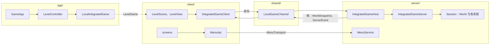

[English](ARCHITECTURE.md)

# 架构

游戏代码位于 `assets/scripts/`：服务端运行游戏逻辑，客户端负责绘制并发送玩家的指令，两端通过共享的代码加载同一份内容，即基础游戏和各个模组。

文中“类型”指定义的 `kind`（即服务端的类），“定义”指某个 ID（`typeId`）对应的玩法定义或表现定义。

## 概览

游戏由客户端和服务端组成，两者运行在同一进程中。服务端负责运行战斗，客户端负责绘制画面并发送命令。两端加载相同的内容（基础游戏与模组），因此两端都需要的规则只在 `shared` 中实现一次。

### 目录结构

全部游戏代码位于 `assets/scripts/` 下。

| 目录 | 内容 |
| --- | --- |
| `server/` | 权威的战斗逻辑：世界的类型化列表与各系统、固定 0.01 秒的逻辑步（每秒 100 步）、确定性随机数、服务端存档（严格解析），以及菜单后端（`server/menu`）。 |
| `shared/` | 协议、内容格式及其校验、通道，以及 C++ 内核的封装（`shared/kernel`）。 |
| `client/` | 视图、输入、音频与资源加载。只读取快照和事件，并通过命令改变战斗。 |
| `app/` | `GameApp`（菜单外壳）、`LevelController`（关卡的生命周期、存档与读档）、`LocalIntegratedGame`、`LocalMenuApi`、模组加载器和存档协调器。 |
| `core/` | 全局时钟 `gameClock`，以及跟随它的补间动画。 |
| `platform/` | 依赖引擎的设备与设置衔接代码：震动反馈、选项（音量、全屏）、调试设置与调试指令。 |

主场景挂载 `app/GameApp.ts`。它协调菜单外壳，并通过 `app/LevelController.ts` 启动 `LocalIntegratedGame`。战斗逻辑在 `server` 中运行，客户端消费协议中的快照和事件。

### 导入边界

`server` 和 `shared` 不导入任何引擎代码，可以原样在 Node 测试中运行。`tests/architecture/import-boundaries.test.ts` 检查以下边界：

| 目录 | 不得导入 |
| --- | --- |
| `server` | `app`、`client`、`platform`、`core`、引擎（`cc`） |
| `shared` | `app`、`client`、`server`、`platform`、`core`、引擎（`cc`） |
| `client` | `server`、`app` |
| `core` | `app`、`client`、`server`、`platform`（只依赖引擎） |

不要在 `server` 和 `shared` 中导入引擎。

### 主要流程

- **战斗**：客户端发送 `GameCommand` → `IntegratedGameHost` 将其加入 `IntegratedGameServer` 的队列，服务端检查命令并运行各系统 → 服务端返回 `WorldSnapshot` 与若干 `ServerEvent` → `LevelView`、它的各个 presenter 以及实体视图据此更新。
- **菜单**：`screens → client/api/MenuApi → MenuTransport → server/menu/MenuService`。页面从不直接修改玩家档案。
- **内容**：玩法定义和表现定义是位于 `mods/pvz-base/gameplay/` 与 `mods/pvz-base/presentation/` 下的 JSON，按类别拆分，打包为 `assets/resources/base.zip`。基础内容与所有模组使用相同的 `manifest.json` / `content.json` 和相同的注册表。
- **模组**：模组通过 `register({ host, assets })` 接入，用 `host.around()` / `host.replace()` 包装宿主方法，详见[模组](MODS.zh-CN.md)。

### 设计原则

- 新内容优先用数据表达（例如僵尸的 `helm` 和 `shield` 槽位）。
- 通用的渲染器和系统从不按定义 ID 分支。只有某一类型才有的行为，放在该类型的类和视图中（`PlantViewRegistry`、`ZombieView` 等）。

## 协议

### 世界快照

`WorldSnapshot`（`shared/protocol/snapshot.ts`）逐一列出它携带的字段，由 `validateWorldSnapshot` 检查。

基础游戏自身的状态有专门的字段，游戏中没有相应内容时字段不出现：

| 字段 | 内容 |
| --- | --- |
| `tools` | 本局的工具：`owned`（拥有的），以及当前 `available`（可用的）。 |
| `conveyor` | 传送带已移动的 `ticks`。 |
| `dialog` | 戴夫当前台词的 `index`，以及它的是/否提问 `question`。 |
| `debug` | 调试规则，在某条指令设置过之后出现。 |

`extensions` 只携带两类数据：

- 模组在实体上注册的数据（`entity.extensions`），按数据 ID 存放；
- 关卡规则的 `snapshot`，按规则的类型存放，由该规则的客户端视图解析。

每个实体类在自己的 `snapshot` 方法中列出它展示的字段（`Plant.snapshot`、`Zombie.snapshot`、`Projectile.snapshot`、`Mower.snapshot`），只有该类型才有的字段放在 `snapshotOwn` 中；`server/session/snapshot.ts` 负责汇总，并直接列出物品的字段。因此，服务端给实体新增的数据，在某个快照明确列出之前都只留在服务端。

### 本地通道

本地通道（`shared/channel`）对每个客户端数据包先做一次 JSON 往返，再进行解析。

服务端数据包按类型处理：

- **帧**是最频繁的数据包，服务端用新建的对象构造其中的每个快照和事件。因此帧只经过校验（`validateServerPacket`）就直接交出，不做复制。
- **其他服务端数据包**可能引用服务端状态。`copyServerPacket` 在一次遍历中检查其 JSON 安全性并做深拷贝，然后再进行协议的结构检查。

嵌套的模组状态、扩展数据和事件也以同样方式复制或检查，客户端修改自己持有的数据不会影响服务端或其他快照。客户端请求、外部数据包解析和存档格式各自遵循自己的规则。

### 逻辑步、帧与插值

`IntegratedGameHost`（`server/session/IntegratedGameHost.ts`）根据客户端的帧时间驱动服务端：

- 它累计每帧的秒数，每累计满一个逻辑步（`TICK_SECONDS`，0.01 秒）就运行一步。一次更新若需要超过 1000 步，游戏以 `tick-limit-exceeded` 终止。
- 追赶多个逻辑步时，它只为最后两步、暂停和存档点构造快照（客户端每次更新只根据最后两帧渲染），事件则全部保留。
- `requestSave` 是一道屏障：之后的数据包要等到存档在某个逻辑步边界、且没有待处理命令时完成后才处理。
- 只有在创建宿主时启用了调试，才接受 `debugCommand` 数据包。

命令在两个位置之一执行（`server/session/commands.ts`）：

- **会话命令**（`pause`、`resume`、`completeIntro`、`syncPurse`、`advanceDialog`、`answerDialog`、`chooseSeed`、`confirmSeeds`、`finishRepick` 以及调试指令）随时在逻辑步之间执行。
- **玩家输入**在下一个逻辑步的 `command` 阶段执行；客户端以零时长更新时，则在逻辑步之间执行（`LevelInputPresenter` 用这种方式在触摸移动到来之前确认工具的选中）。

在逻辑步之间改变画面的命令会推进会话的 `tick`，但不推进 `gameplayTick`，因此客户端会收到同一逻辑步的新帧。

客户端在最近两个逻辑步之间插值绘制（`ClientWorld.render`，按宿主的 `interpolationAlpha`）：

- 同一逻辑步的新帧（输入或暂停）会替换当前快照，但保留插值历史（`ClientWorld.accept`）。
- 暂停时宿主保留已推进的不足一步的时间（累加器），画面停在原处。
- 失败时以及重新选卡期间，客户端原样绘制最后一帧，不做插值。

## 服务端

### 目录布局

`server/` 根目录下不放文件：

| 目录 | 内容 |
| --- | --- |
| `session/` | 游戏生命周期：`IntegratedGameServer`、`IntegratedGameHost`、`session`、`commands`、`snapshot`、`persistence`、`save`、`savedLists`、`createModHost`，以及生成的 `hostModules`。 |
| `state/` | 世界（`World`，以及 `Entity`、`Position` 和 `EntityRemover`）、关卡资源（`resources`）、事件队列与随机数。 |
| `registry/` | 模组注册表：`GameplayRegistry`、`EntityExtensions`，以及 `kindFields`（检查类型的定义字段）。 |
| `level/` | 关卡流程：`level`、`levelAward`、`waves`、`conveyor`、`loot`、`sun`，以及用于查询草坪上内容的 `lawn`。 |
| `rules/` | 关卡规则：`registry`，以及内置的 `adventure`、`bowling` 和 `whackAZombie`。 |
| `seeds/` | 种子栏、选卡界面、种植、光标与工具。 |
| `combat/` | 目标选择、爆炸、碰撞、减速与冻结（`cold`、`freeze`、`ice`）。 |
| `projectiles/` | `Projectile`、`MowingProjectile`、`ProjectileRegistry`、`motions`、`projectiles`。 |
| `mowers/` | 各行的小推车：`Mower`、`mowers`。 |
| `items/` | 物品：`items`、`itemSpawn`。 |
| `gridItems/` | 格子物品：`gridItems`、`graves`、`craters`。 |
| `achievements/` | 成就及其触发条件。 |
| `plants/`、`zombies/`、`tutorials/`、`debug/`、`menu/` | 各自的领域。 |

客户端把每种实体的视图放在同名目录中（`plants/`、`zombies/`、`projectiles/`、`mowers/`、`items/`、`gridItems/`）。

模组按模块在 `assets/scripts` 下的路径获取任意模块（`host.get('server/state/resources')`），模块列表由 `npm run mod:hosts`（`tools/mod/hosts.ts`）生成。服务端宿主提供 `server` 和 `shared` 下的模块，客户端宿主提供 `client`、`shared`、`platform` 和 `core` 下的模块。`createModHost` 另外加入少数不是模块的值（`gameplay/registry`、`client/views`）。模块移动后，它的 ID 随之改变。

关卡的共享逻辑分布如下：

- `level/level.ts` 初始化共享的关卡状态，并推进关卡进度。
- `state/resources.ts` 定义关卡、经济、种子栏、波次、教程和天降阳光的状态及其资源。
- 每种实体的类型位于各自的模块：`items/items.ts`、`gridItems/graves.ts`、`gridItems/craters.ts`，以及 `Plant`、`Zombie`、`Projectile`、`Mower` 这几个类。
- `level/sun.ts`、`items/items.ts`、`level/waves.ts` 和 `zombies/groans.ts` 提供共享的天降阳光、物品、波次/奖励和僵尸呻吟逻辑。进度、波次和呻吟系统的 ID 分别为 `pvz:level-progress`、`pvz:waves` 和 `pvz:zombie-groans`。

### 世界与实体

世界（`state/World.ts`）由若干类型化列表组成，不使用 ECS 组件：`items`、`gridItems`、`plants`、`projectiles`、`mowers` 和 `zombies`，与世界的 `resources` 并列。每个列表都是一个 `EntityList`，按 id 直接保存对象本身，并按 id 顺序遍历。

实体就是它在某个列表中的对象：

- `createEntity` 只分配 id，id 永不复用。
- `insert` 把对象放入列表，`destroyEntity` 将其移出。
- 系统的 `commands`（一个 `CommandBuffer`）把这两种操作推迟到所在阶段结束时执行。`commands.destroyEntity` 会让实体立即从所有列表中隐藏（`markDestroy`）。

### 会话与调度

一局游戏是一个 `Session`（`session/session.ts`）：包括世界、时钟（`tick`、`gameplayTick`）、命令队列以及本局的内容定义。

- `createSession` 安排逻辑步的各阶段和系统顺序；`startSession` 开始新的一局。
- `IntegratedGameServer` 只负责调度：开始或恢复一局游戏、排队命令、推进逻辑步，并输出快照和事件。
- 成就在每个事件发出时观察它（`observeAchievements`），玩法逻辑只负责报告发生了什么。

每个阶段依次运行其系统，然后刷新该阶段的命令缓冲：

| 阶段 | 系统 |
| --- | --- |
| `command` | `pvz:commands`（排队中的玩家输入） |
| `tutorial` | `pvz:level-progress` |
| `spawn` | `pvz:waves`、`pvz:board-ice`、`pvz:craters`；之后是关卡规则的系统（`LevelRuleDefinition.systems`），这些系统也可以放在后面的阶段，位于波次系统之后 |
| `plant` | `pvz:plant-chill`、`pvz:plant-attacks`、`pvz:plant-production`、`pvz:plant-abilities`、`pvz:conveyor`、`pvz:plant-rolls`、`pvz:plant-animation` |
| `zombie` | `pvz:zombie-groans`、`pvz:zombie-lifecycle` |
| `mower` | `pvz:mower` |
| `projectile` | `pvz:projectile` |
| `item` | `pvz:items` |

开场期间服务端不运行战斗逻辑步，只等待 `completeIntro`。只有带 `plantsLiveInIntro` 的教程（坚果保龄球）会在开场期间运行其植物的动画。

### 玩家操作规则

玩家操作的规则按对象拆分：

| 模块 | 规则 |
| --- | --- |
| `seeds/planting.ts` | 哪些种子可选、选卡、种植、创建植物、放置僵尸种子的僵尸、查找格子中的植物 |
| `seeds/tools.ts` | 铁铲及其他工具 |
| `items/items.ts` | 收集阳光、金币和关卡奖励 |
| `session/commands.ts` | 分派每条命令，以及哪些命令在逻辑步之间执行 |
| `session/snapshot.ts` | 构造 `WorldSnapshot` |
| `session/persistence.ts` | 世界与存档之间的相互转换；存档的格式和检查位于 `session/save.ts` |

每个规则函数的第一个参数都是 `Session`。规则之间通过各模块导出的对象互相调用（`planting`、`tools`、`items`、`commands`、`snapshot`），因此模组用 `host.around` 包装这些对象的方法后，宿主自身的调用也会经过包装。

### 战斗

战斗代码按对象组织。模块直接导入它依赖的内容，没有共享的转发模块。

植物（`server/plants/`）：

- 每株植物都是其类型对应类的实例，按玩法定义的 `kind` 选择（`PlantRegistry`，见[植物](#植物)）。
- `attacks.ts` 运行植物的攻击（各类型的 `attack`；射手类的实现在 `Shooter.ts`）。
- `production.ts` 运行产出，`abilities.ts` 运行特殊能力（`act`），`rolls.ts` 运行保龄球坚果的滚动（`roll`）。
- `damage.ts` 处理植物被啃食或被击毁，以及它的死亡爆炸。

僵尸（`server/zombies/`）：

- `system.ts` 运行每只僵尸的逻辑步（`Zombie::Update`）。
- `animation.ts` 计算地面轨道和动画时间。
- `damage.ts` 处理伤害与死亡。
- `Zombie.ts` 是僵尸类。`FlagZombie.ts`、`PoleVaulter.ts`、`Newspaper.ts` 和 `Dancer.ts` 继承它，`ZombieRegistry.ts` 按定义的 `kind` 选择其中之一。
- `spawn.ts` 包含所有僵尸共用的生成规则。

其他：`projectiles/projectiles.ts` 运行子弹，`combat/explosions.ts` 处理范围爆炸，`combat/collision.ts` 只提供几何计算。

`GameplayRegistry` 只保存模组可以注册的内容：植物、僵尸和子弹的类型，模组在实体上的数据（`extensions`），关卡规则，成就触发类型，子弹运动方式和教程。

### 小推车

每行的小推车（原版的 `LawnMower`）在该行尽头等待，直到被触发。

- **等待**：`startSession` 为每个启用的行创建一辆（`Board::InitLawnMowers`；`mowers/mowers.ts` 中的 `createMower`），位于 `MOWER_READY_X`。它是世界 `mowers` 列表中的一个 `Mower`（`mowers/Mower.ts`），其 `typeId` 为关卡的 `lawnMower`。
- **触发**：僵尸碰到它时，`Mower.setOff`（`LawnMower::StartMower`）将它从所在行移除，并在原位置发射一个该定义的子弹。这个子弹是一个 `MowingProjectile`（`projectiles/MowingProjectile.ts`，子弹类型为 `mowing`），拥有自己的实体。
- **行进**：子弹系统在其他子弹之后移动它（`Board::UpdateGameObjects` 最后更新小推车）。它碾过僵尸和植物，并在碾压时减速（`chompCounter`）。
- **被碾的植物**：被它碾过的植物以 `mowered` 状态（`state`）留在世界的 `plants` 中，直到压扁动画播完。它已不在场上，`level/lawn.ts` 中的 `plantsInPlay` 会跳过它。

两者不是同一个类：等待中的小推车不是子弹，行进中的小推车也不是 `Mower`。

其他规则：

- 关卡胜利后，从最下面一行开始，每辆等待中的小推车每隔 40 个逻辑步在原位变成一枚金币并消失（`level/loot.ts` 中的 `updateMowerCoins`，`Board::UpdateLevelEndSequence`）。
- 2-1 关的存款上限同时计算等待中和行进中的小推车（`level/lawn.ts` 中的 `lawnMowerCount`，`mLawnMowers.mSize`）。
- `/lawnmower reset` 会在没有等待中小推车的行放置一辆新的。
- 现有内容中没有会压坏小推车的东西（`MOWER_SQUISHED`）。

开场时小推车的驶入只是表现。原版的 `MOWER_ROLLING_IN` 只用于额外的小推车（`mBonusLawnMowersRemaining`）；开场的小推车处于 `MOWER_READY`，由 `CutScene::UpdateIntro` 按过场动画自身的时间摆放。本项目中开场的时间属于客户端，因此驶入是小推车视图按该时间绘制实体的结果（见[其他实体视图](#其他实体视图)），不是服务端状态。

在协议和存档中：

- 快照的 `mowers` 列出等待中的小推车（`MowerSnapshot`）；行进中的小推车位于 `projectiles` 中。
- 存档把等待中的小推车保存在 `mowers` 中（`{id, position, typeId}`），把行进中的保存在 `projectiles` 中，连同其 `chompCounter`。

### 子弹

子弹和植物、僵尸一样分类型。子弹定义的 `kind`（省略时为 `projectile`）是它的服务端类（`projectiles/ProjectileRegistry.ts` 中的 `ProjectileRegistry`），表现定义中同名的 `view` 是它的客户端视图。

- 每颗子弹都是世界 `projectiles` 列表中的一个对象，即它的实体，带有 `id` 和 `position`（作为字段保存）。
- `launchProjectile`（`projectiles/Projectile.ts`）按定义的类型创建子弹，并开始它的运动（`Projectile.launch`）。
- `Projectile` 对命中的对方单位造成 `damage`（`canHit`、`strike`；也包括西瓜的溅射）。`MowingProjectile` 则直接碾压。
- 两者如何飞行都由其运动方式决定（`motions.ts`）。

内容检查（`ProjectileRegistry.validate`）要求：

- 每个定义恰好带有其类型接受的字段（`projectile` 带 `damage`，`mowing` 不带任何字段）；
- 植物的 `shooter.projectile` 不覆盖其子弹类型所没有的字段；
- 每个关卡的 `lawnMower` 属于会碾压的类型。

### 存档

一份关卡存档是一份游戏存档，包含服务端和客户端两部分。所有格式都严格解析，旧版本一律拒绝读取。

| 存档 | 模块 | `schemaVersion` | 内容 |
| --- | --- | --- | --- |
| 游戏存档 | `app/SaveCoordinator.ts` | 2 | 玩家档案、关卡、内容组合（基础内容与模组）、服务端存档和客户端表现 |
| 服务端存档 | `server/session/save.ts` | 5 | 关卡 ID 与场地种子、启用的模组、时钟、实体分配器、随机数，关卡、经济、种子栏、教程、天降阳光、波次和事件队列的状态，成就进度，以及每个类型化列表各一个数组 |
| 客户端表现 | `client/game/ClientPresentationSnapshot.ts` | 3 | 客户端最近两个快照（含 `mowers`）以及关卡表现 |
| 关卡表现 | `client/level/LevelPresentationSnapshot.ts` | 5 | 流程、开场、结束、提示、HUD 和音频状态，各视图的条目，受击闪光 `flashes`，粒子，以及模组的 `extensions` |

在服务端存档中，列表的每一项是对象的字段，加上它的 `id`、`position`（格子物品没有）以及模组的 `extensions`。id 在所有列表间唯一，且小于 `allocator.nextEntity`；`session/savedLists.ts` 解析并检查每个列表的条目。

## 关卡、关卡规则与教程

### 关卡

普通关卡在 `mods/pvz-base/gameplay/levels.json` 中配置行、初始阳光、种子、波次和奖励，不需要编号的服务端文件。目前已包含冒险模式 1-1 至 2-10。

波次要么直接列出，要么由关卡规则生成，一个关卡只能二选一：

- 直接列出：`waves: [{ zombies, flagWave?, points? }]`，如 `mods/example` 所示；
- 由已注册的关卡规则生成：`rules: { kind, count, ...settings }`。

波次计划在游戏开始时拟定，并随存档保存。

### 教程脚本

教程脚本按 ID 注册在 `GameplayRegistry.tutorials` 中（`server/tutorials/index.ts`）：

- 基础游戏的脚本通过 `installBuiltinTutorials` 注册；
- 模组的脚本通过 `registry.tutorials.register(ownerId, id, script)` 注册。

关卡的 `tutorial` 指定其中一个脚本，在内容校验时检查。运行中的游戏从世界中查找脚本：`levelTutorial` 返回关卡的脚本，`getActiveTutorial` 在脚本生效时返回它（首次冒险时，除非脚本被跳过；或对 `alwaysActive` 的脚本始终生效）。游戏通过它分发各种回调：选卡、取消、种植、冷却完成、收集阳光和金钱、选择工具、移除植物以及对话。

- 没有脚本的关卡省略 `tutorial`，使用共享流程。
- 基础脚本的步骤是 `TUTORIAL_STEPS`，模组的步骤位于其命名空间中。
- `plantingTutorial.ts` 和 `sunflowerTutorial.ts` 只包含各自的特殊引导。
- 特殊教程只需注册脚本，不会在主服务端中增加关卡分支。

只属于某一关的流程放在该关位于 `server/tutorials` 下的脚本中，关卡的 `tutorial` 只负责指定脚本。这包括戴夫的对话、铁铲教学的初始植物、2-1 关的首枚金币与存款上限、选卡警告，以及戴夫出售卡片槽的提议。

影响关卡的脚本字段：

| 字段 | 作用 |
| --- | --- |
| `dave` | 让疯子戴夫在开场时登场对话。 |
| `dialogQuestion` | 把当前台词标记为是/否提问，客户端用 `answerDialog` 回答。 |
| `blocksIntro` | 阻止开场结束。 |
| `blocksStart` | 阻止僵尸到来。与 `blocksIntro` 相互独立。 |
| `skips` | 条件成立时，首次冒险不运行该脚本，例如卡槽里没有豌豆射手时的种植教程。开局时检查，成立则按重玩开局；关卡进行中也会检查，成立时由 `skipped` 放开脚本压住的内容。 |

### 工具

工具即玩法定义中的 `tools` 表，按 ID 索引。每个工具都有一个说明其作用的 `kind`：`shovel` 表示 `tools.use` 会铲除格子中的植物，客户端会高亮指针下的那株植物。

- 关卡的 `tools` 和 `tool` 类奖励都必须指向某个工具，并且每个工具都需要表现定义 `tools` 中的外观。
- 工具来自奖励：通关时，工具类奖励会把工具记入玩家档案，此后每关都有。关卡自己的 `tools` 会替代奖励获得的工具。

铁铲是一个 `UIButton`，触摸操作与种子包相同：按下拿起，拖动瞄准，松开使用，拖回按钮上则取消。教程中可以使用，暂停会结束当前手势。

### 选中状态

服务端的 `SeedBankState.selection` 是四种互斥状态之一：未选中、种子栏中的种子包、传送带上的种子包、工具。

- 传送带上的选中只记录种子包的 ID，由 `server/seeds/seedBank` 中的 `selectedSeedId` 找到对应的种子。
- 存档保持相同的结构，旧格式中并列字段的写法不再兼容。

### 传送带

关卡玩法定义中的 `conveyor` 描述传送带：容量 `capacity`、间距 `spacing`、移动周期 `moveTicks`、供应权重 `seeds`，以及按传送带上种子包数量划分的生成间隔（`spawnDelay`，按 `minPackets`）。表现定义中的 `conveyor`、`tools` 和 `dave` 表保存布局、动画资源、速率以及对话的表现设置。

### 种植红线与种植判定

关卡的 `plantingLine: {column}` 是它的红线（坚果保龄球）：玩家不能在该列右侧种植，第一次尝试时提示 `ADVICE_NOT_PASSED_LINE`。这是下文共享种植判定中的一项检查。关卡表现定义中的 `plantingLine`（`{sprite, offset, dialogs}`）负责在战斗中以及列出的戴夫台词期间绘制它。任何关卡都可以设置红线，无论是否使用关卡规则。

种子能种在哪里，对两端来说是同一个判定：`shared/content/planting.ts` 中的 `plantingRefusal`（`Board::CanPlantAt`）。它读取一个 `PlantingLawn`，两端各自根据自己的状态构建：服务端基于其 World，客户端基于快照（`snapshotLawn`）。

- 服务端对每种拒绝原因给出相应的拒绝码和提示。
- 种植预览只显示是否会被拒绝。

其下的格子规则同样两端共享：

- `holdsCell`：滚动中的坚果和正被小推车碾压的植物不占用格子；
- `canShovel`：铁铲及其高亮；
- `graveAt`（`shared/content/graves.ts`）。

### 关卡规则

除了生成波次，关卡规则（`server/rules/registry.ts` 中的 `LevelRuleDefinition`）还可以在原版 Board 调用 Challenge 的位置改变玩法。通用代码只调用这些钩子，从不检查关卡或规则的 ID。

| 成员 | 用途 |
| --- | --- |
| `validate`、`draft` | 检查规则的设置；在随机挑选之前拟定波次（必需）。 |
| `systems` | 关卡加入调度的系统，位于所在阶段的波次系统之后。 |
| `spawnsZombies` | 由规则自行生成僵尸，波次系统不再出怪。 |
| `initialize` | `Board::InitLevel` 和 `Challenge::StartLevel`，在关卡脚本之前执行。 |
| `boardClick` | 点击场地且未命中其他东西时（`Challenge::MouseDown`）。 |
| `cursorCleared` | 光标清空之后（`Challenge::ClearCursor`）。 |
| `dropsRefusedSeeds` | 无法种在目标位置的种子直接丢弃，而不是留在手中。 |
| `canPlantAt` | 规则在 `Board::CanPlantAt` 中负责的部分。 |
| `dropLoot` | 掷骰之后接管战利品掉落。 |
| `holdsAward` | 暂时阻止关卡奖励掉落。 |
| `parseState`、`snapshot` | 检查存档中的 `wave.ruleState`；在 `extensions[kind]` 下向客户端展示规则状态。 |

规则的 `canPlantAt(lawn, seed, row, column)` 就是 `shared/content/planting.ts` 中的 `LevelPlantingRule`，对植物种子在检查红线之前询问。规则只写一次该函数，并把同一个函数交给它的客户端视图（`LevelRuleView` 继承自它），种植预览会询问这个函数。

规则把自己的状态保存在 `wave.ruleState` 中（由 `parseState` 检查），并通过 `extensions[kind]` 展示给客户端，由其客户端视图解析。客户端部分是 `client/level/rules/` 中的一个视图（`registerLevelRuleView`），其设置位于 `presentation/definitions/rules.json`。

模组通过 `GameplayRegistry.levelRules.register(owner, kind, { validate, draft, ...hooks })` 加入新的规则类型。

### 内置规则

| 规则 | 行为 |
| --- | --- |
| `pvz:adventure` | 首次冒险时的 `Board::PickZombieWaves`（见下文）。 |
| `pvz:bowling` | 冒险模式的波次，点数为四倍，且不掉落金钱。 |
| `pvz:whack-a-zombie` | 自行生成僵尸，自行计算波次。 |

`pvz:adventure` 生成：

- 每波的点数，以及带有普通僵尸和旗子僵尸的旗帜波；
- 可选的 `pointsScale`（1-10 关为 3）；
- 在随机挑选之前放入的 `fixedZombies`（关卡新引入的僵尸，出现在第“总波数/2+1”波和最后一波）；
- 最后一波会补上 `zombiePool` 中权重不为零、但尚未出现的每种僵尸，按池中顺序加入（`PutInMissingZombies`）。

旗帜波先放入最多 `maxPlain`（8）只 `plain` 僵尸（普通僵尸，每个冒险关卡的僵尸池都必须包含它；`Board::PickZombieWaves`），再放入玩法设置中 `flagWave.zombie` 指定的僵尸（旗子僵尸，`ZOMBIE_FLAG`）。冒险关卡开场前街道上展示的僵尸不包含这只僵尸（`CutScene::PlaceStreetZombies`）。

规则自行检查其设置。`zombiePool` 的条目可以是僵尸 ID（其 `points`、`weight` 和 `firstWave` 取自该僵尸的 `wave`），也可以是覆盖这些值的对象。

### 波次预告

波次由 `server/level/waves.ts` 中的 `nextWaveComing`（`Board::NextWaveComing`）预告：

- 波次系统在每波到来前 5 个逻辑步调用它，一大波则在倒计时结束时调用。
- 自行生成僵尸的规则，在自己对各波 `nextWaveAtTick` 的倒计时中调用它。
- 最后一波之前显示最后一波的横幅，第一波之前播放 awooga 号角；其余情况下，在调用方指定时（旗帜波）播放警笛声。
- `wave.announcedWave` 保证每波只预告一次，存档读档后也不会重复。
- 客户端在 `LevelAudioPresenter` 中播放其音效（`nextWaveComing` 事件）。

一大波的提示文字是关卡的提示（`AdviceWidget`，样式为 `huge-wave`，对应 `MessageWidget` 的 `MESSAGE_STYLE_HUGE_WAVE`）。它按原版的 TextFadeOn 出现和消失（`pvz:textfadeon_enter`、`pvz:textfadeon_leave`），期间给出的其他提示会等它消失后再显示（`MessageWidget::SetLabel`、`ClearLabel`）。

## 内容定义

### 文件与打包

玩法定义的编写表位于 `mods/pvz-base/gameplay/definitions/`，拆分为植物、僵尸、种子、场地、子弹、物品、成就、工具、商店、商店页面和图鉴。`gameplay/settings.json` 包含全局默认值，`gameplay/levels.json` 包含关卡。

表现定义表位于 `mods/pvz-base/presentation/definitions/`，按类别拆分成多个文件：植物与僵尸的动画、种子包图片、视图选择、部件轨道、阴影、掉落图片、场地、关卡、商店等。

根目录的 `mods/pvz-base/content.json` 以与模组源码相同的格式索引所有表。打包（`npm run mod:pack`，`tools/mod/cli.ts`）把它们合并为包内的 `assets/gameplay.json` 和 `assets/presentation.json`，结构与模组包相同，不增加额外的资源请求。基础内容包发布到 `assets/resources/base.zip`（`npm run mod:pack -- pvz-base --publish assets/resources/base.zip`，`npm run build:content` 也会执行这一步）。无界面工具和测试读取同一套源表（`tools/mod/content.ts`）。

类型与解析器位于 `shared/content`：`presentation.ts` 负责表现定义，`gameplay.ts` 汇集玩法定义的各部分（`gameplayTypes`、`parseGameplay`、`levelHelpers`、`seedGroups`）。

植物和僵尸的数值与原版一致。

### 加载与校验

玩法配置和表现配置分别使用 `GameplayDefinitions` 和 `PresentationDefinitions`。两者都经过加载、校验，以对象形式返回，再注入给使用方。

- 两个解析器都只接受对象自身的字段（`shared/validate.ts` 中的 `exact` / `fields`），只返回读取并检查过的内容，点、二元组和范围的读取函数共用同一份实现。
- `ClientAnimationRegistry` 以解析后的表现定义为起点，只补全片段省略的内容（零偏移、`rateScale` 为 1），然后冻结这些片段。片段的字段在读取表现定义时检查（`parsePresentationDefinitions`）。
- `loadIntegratedGameContent` 返回 `definitions` 和 `presentation`；UI 通过 `UIAssets.presentation` 持有自己的定义。
- 动画注册表、实体视图和种子包都显式接收定义，而不是查询全局配置状态。

### 注册与修改

`shared/content/DefinitionRegistry` 通过通用的 `Registry` 注册基础内容和模组的 JSON，注册完成后校验引用，然后冻结结果。

- 服务端条目注册玩法表和关卡。模组自己命名空间的条目作为新定义注册；写在其他命名空间 ID 下的条目以及它写的表外设置，都是对基础内容和在它之前加载的模组所定义内容的 JSON 合并补丁。模组按加载顺序依次处理，然后检查结果。
- 客户端条目以同样方式注册表现表和名称。
- `PlantViewRegistry` 从同一个注册表创建内置视图和模组视图。
- UI 和关卡使用同一套模组表现定义，包括新增的动画目标。

参见 [Mod Lab](../mods/example/README.zh-CN.md)，以及[模组](MODS.zh-CN.md)中开发与打包部分介绍的注册接口。

### 植物

每株植物属于一个类型，即它的服务端类，由玩法定义的 `kind` 选择（省略时为 `plant`），正如它的视图由表现定义的 `view` 选择。类型注册在 `PlantRegistry`（`GameplayRegistry.plants`）中：

| `kind` | 服务端类 | 基础游戏中的植物 |
| --- | --- | --- |
| `plant` | `Plant` | 莲叶 |
| `shooter` | `Shooter` | 豌豆射手、双重射手、寒冰射手、小喷菇、大喷菇 |
| `scaredyshroom` | `ScaredyShroom`（继承 `Shooter`） | 胆小菇 |
| `producer` | `Producer` | 向日葵 |
| `sunshroom` | `SunShroom`（继承 `Producer`） | 阳光菇 |
| `fuse` | `FusePlant` | 樱桃炸弹、冰川菇、末日菇 |
| `potatomine` | `PotatoMine` | 土豆地雷 |
| `chomper` | `Chomper` | 大嘴花 |
| `gravebuster` | `GraveBuster` | 咬咬碑 |
| `hypnoshroom` | `HypnoShroom` | 迷糊菇 |
| `wallnut` | `WallNut` | 坚果、爆炸坚果 |
| `bowlingnut` | `BowlingNut` | 坚果保龄球中的坚果 |

每个定义恰好带有其类型接受的定义字段，不带其他类型接受的字段（`checkKindFields`），因此一株植物至多有一种攻击或能力：

| 字段 | 行为 |
| --- | --- |
| `shooter` | 按节奏攻击。`shooter.type` 为 `shooter`（沿本行直线）、`lobber`（投掷）或 `seeker`（追踪）。 |
| `fright` | 与 `shooter` 一起使用，会躲藏（胆小菇）。 |
| `producer` | 产出物品（向日葵）。带 `growth` 时会长大，如阳光菇。 |
| `fuse` | 引信燃尽后生效：樱桃炸弹在 100 个逻辑步后造成 3x3 的灼烧爆炸；用 `freeze` 代替 `explosion` 即为冰川菇。 |
| `mine` | 土豆地雷：1500 个逻辑步后出土，出土过程 106 步，爆炸伤害 1800，不留尸体。 |
| `chomper` | 大嘴花：咬合 70 个逻辑步，之后消化 4000 个逻辑步。 |
| `graveBuster` | 咬咬碑。 |
| `mindControl` | 醒着的迷糊菇会让吃掉它的僵尸或植物转到它的阵营。 |
| `bowling` | 保龄球坚果的滚动。 |

不带以上任何字段的植物只起阻挡作用（坚果）。`deathExplosion` 可用于任何类型，使爆炸坚果在被啃食或被击毁时爆炸。

`server/plants/abilities.ts` 中的 `pvz:plant-abilities` 系统通过植物的类型推进其自身行为（`Plant.act`）。各状态播放的片段、眨眼和土豆地雷的指示灯都属于植物的动画，由服务端通过 `shared/content/plantAnimation` 推进。`client/plants` 下的视图根据快照绘制动画，`WallNutView` 另外绘制坚果的裂纹。

### 动画定义

僵尸的 `animation` 写法与植物相同：

- `clips`：帧、`fps`（一个速率或 `[min, max]`）、`start`、`hold`，以及用于行走片段的 `ground` 和标记啃咬与倒地时刻的 `marks`；
- `layers`：每个动画层播放哪个片段（`{body: walk}`）。

`ground` 是 Reanim 中 `_ground` 轨道的 x，按行走者的朝向计算：僵尸按 Reanim 原样，植物取反（植物的 Reanim 朝右）。

- 僵尸的行走片段没有 `fps`，由移动速度决定节奏。
- 植物的片段可以两者都有，例如保龄球坚果的滚动（`wallnut_roll`）。坚果按照与僵尸行走相同的 `groundStep`（`Reanimation::GetTrackVelocity`）滚动。
- 在其中写 `from`（`"animation": {"from": "pvz:normal"}`）表示以同一张表中另一条定义的动画为起点，与 `from` 并列写的内容叠加在其上。

表现定义的 `clips` 保存同名片段（`walk`、`eat`、`death`……）的图片，同样支持 `from`（`shared/content/from.ts`）。植物和僵尸的快照都按动画层携带 `animations`，由 `shared/content/animation` 推进。

### 僵尸

僵尸的定义字段：

- `tongueChance` 和 `walk2Chance` 选择外观变体。
- 植物能力的 `targeting` 配置攻击范围，以及僵尸识别它的键（`insetKey`）：僵尸的 `targetingInsets` 为它提供的内缩量，以及僵尸自身机制是否会躲过它。
- 撑杆跳之后的攻击使用 `vault.landedAttack`。

无论类型如何，所有僵尸都有相同的状态（`shared/content/zombieStates.ts`：`walking`、`eating`、`airborne`、`dying`、`burned`、`mowered`）。在空中的僵尸处于 `airborne`：草坪上的东西够不到它（地面武器不会以它为目标，小推车碾到它只会让它化为烟雾，火焰直接移除它，它也不投下阴影），它进入和离开这一状态只由自身机制决定（撑杆僵尸的撑杆跳；原版的空中阶段）。

每只僵尸属于一个类型，即它的服务端类，由玩法定义的 `kind` 选择（省略时为 `zombie`），正如它的视图由表现定义的 `view` 选择，服务端类与视图类一一对应。这些类位于 `server/zombies/`，注册在 `ZombieRegistry`（`GameplayRegistry.zombies`）中：

| `kind` | 服务端类 | 客户端视图 | 专有定义字段 | 专有存档字段 | 专有快照（`own`） |
| --- | --- | --- | --- | --- | --- |
| `zombie` | `Zombie` | `ZombieView` | — | — | — |
| `flag` | `FlagZombie` | `FlagZombieView` | — | — | — |
| `polevaulter` | `PoleVaulter` | `PoleVaulterView` | `vault` | `hasPole` | `hasPole` |
| `dancer` | `Dancer` | `DancerView` | `dance` | `phase`、`phaseTicks`、`age`、`troupe`、`summonTicks`、`leader` | `phase`、`age` |
| `newspaper` | `Newspaper` | `NewspaperView` | `enrage` | `gaspTicks` | `enraged` |

类型的专有定义字段随类型而定：一个定义只带有其类型接受的字段，不带其他类型的字段，在加载内容时检查。

每只僵尸都是其类型的实例，即世界 `zombies` 列表中带有 `id` 和 `position` 的一个对象（由 `ZombieFactoryResource` 创建）：

- 它的字段就是它的全部：所有僵尸共有的字段（`ZombieFields`）加上其类型的专有字段。这些字段都是纯数据（引用另一只僵尸时使用其实体 ID），存档原样保存它们。
- 读档时按其类型恢复，类型从存档中取出自己的字段，并拒绝任何其他字段（`Zombie.restore`、`restoreOwn`；所在存档列表的 `restore`）。
- 定义本身不是僵尸的字段。

游戏的其他部分在不知道具体类型的情况下，向僵尸询问只有其类型才知道的事：

| 问题 | 方法 | 示例 |
| --- | --- | --- |
| 如何登场、如何开始行走 | 构造函数、`start`、`pickSpeed`、`setOffClip`、`walkAgain` | 撑杆僵尸持杆奔跑；暴怒的读报僵尸使用自己的行走片段。 |
| 每个逻辑步自己做什么 | `beforeTick`、`count`、`pauses`、`act` | 舞者僵尸伴舞队的节奏、它的年龄和舞蹈；读报僵尸的喘息；撑杆僵尸的撑杆跳。 |
| 是否啃食、用什么范围啃食 | `eats`、`attackRect`、`passesPlant` | |
| 如何停止啃食、如何行走、如何走进房子 | `stopEating`、`walks`、`intoHouse` | |
| 失去头部、倒地或被碾压时放下什么 | `dropCarried` | 旗子僵尸的旗子，即它的 `flag` 动画层（`Zombie::DropFlag`）。 |
| 失去护盾和被迷糊菇控制时会怎样 | `shieldDropped`、`changedSides` | |
| 植物能对它做什么 | `dodgesBite`（`Plant::UpdateChomper`）、`evades`（按瞄准方式的键，`Plant::FindTargetZombie`） | 持杆的撑杆僵尸会躲过大嘴花的咬合（被冻结时除外），也会被 `vault.evades` 中列出的瞄准方式（土豆地雷的 `pvz:mine`）跳过。 |
| 自己展示和保存什么 | `snapshot`、`validSaved` | |

只有某类型才向客户端展示的内容放在快照的 `own` 中（`snapshotOwn`）。共享快照只检查它是一个对象，由该类型的视图读取并检查（`ZombieView.own`）。因此共享协议不包含任何类型的专有字段，它们只由对应的服务端类和客户端视图类共享。

模组的类型继承上述类之一，并以其定义中 `kind` 所写的名称注册。土豆地雷在客户端计算距离时，读取玩法定义中的攻击矩形和身体矩形。

### 表现定义表

- 表现定义中的 `projectiles`，以及僵尸的 `helm`、`shield` 和 `drops`，定义精灵图、轨道、特效、偏移和音效。
- 音效的 `pitchRange` 控制音高随机化；负值会降低音高，例如读报僵尸撕报纸声的 -2。
- 护具的 `dropSounds` 在护具破碎时与其 `clips.drop` 一起播放，攻击绕过护盾时除外。
- `seedPackets` 保存种子包的闪光特效（`flash`）、选中颜色，以及图片在种子包中的默认位置。植物自己的表现定义 `packet` 可以指定其图片的 `placement` 和 `phase`。
- `almanac` 按植物或僵尸 ID 保存图鉴中展示它所用的背景，以及它的种子包是否为升级植物的样式。
- 表现定义中的 `boards` 定义背景、音乐和失败演出的几何参数；玩法定义中的 `boards.*.bounds` 定义水平边界。
- 动画中带有 `flag` 层的僵尸会举着旗子，旗子按 `Zombie::DropFlag` 的方式掉落。
- 粒子快照保留可选的剩余寿命。种子包闪光使用 `seedPackets.flash`，读档时不按特效 ID 分支。

商店同样按两类定义拆分：

- 玩法定义的 `store` 表按 ID 保存商店的商品（ID 也是玩家档案中该商品数量的键）：每件商品所在的页面和位置（`page`、`place` 0-7）、价格或分档价格、戴夫的一句或多句台词、购买条件、库存规则和购买效果。
- `storePages` 按顺序列出各页面及其开放条件（`level`、`completed`；`StoreScreen::IsPageShown`）。
- `settings.json` 中的 `zenGarden` 是买来的金盏花所去的花园。
- 表现定义的 `store` 表保存每件商品的外观（`sprite`、`offset`、`highlight`），`storeDialogue` 保存商店界面的时间参数和戴夫的闲聊。
- 应用根据玩法定义表构建后端的商品目录。

新内容应新增定义，而不是在共享的渲染器中按具体 ID 分支。视图工厂、专门的能力状态机和单位换算常量仍然是代码。

### 模组入口

模组使用 `register({ host, assets })`：

- `host.get()` 返回宿主模块和注册表；`host.around()` / `host.replace()` 修补实际的方法。没有单独的系统、界面或动画增强门面。
- 模组以 `entity.extensions[id]` 的形式在实体上保存自己的数据，这是一个 JSON 对象，其 id 通过 `GameplayRegistry.extensions.register(id, validate?)` 注册。注册过的数据经过检查，并被复制到存档和快照的 `extensions` 中。
- 服务端规则的第一个参数是本局的 `Session`，并以对象形式导出：`server/seeds/planting`（种子可用性、选卡、种植、创建植物、格子查询）、`server/seeds/tools`、`server/items/items`（拾取）、`server/session/commands`（`execute`，包括 `mod` 命令）以及 `server/session/snapshot`（`build`）。
- `IntegratedGameServer` 只负责开始或恢复会话、排队命令和推进逻辑步；`server/session/persistence` 负责世界与存档之间的转换。

参见 [Mod Lab](../mods/example/README.zh-CN.md) 和[模组](MODS.zh-CN.md)。

## 客户端

### 关卡表现

`client/level/LevelScene` 负责通用的“开场 → 战斗 → 奖励/失败”生命周期、游戏时钟缩放、输入挂起以及表现存档。它依赖 `LevelGame` 客户端接口，而不是本地服务端的传输方式。

`LevelView` 组合 HUD、输入、实体、粒子、音频和结束演出的各个 presenter。`LevelSeedBank` 独立创建和更新每个配置好的种子包。场地几何、启用的行、种子价格和关卡编号都来自已安装的玩法定义。

#### 开场与关卡专属表现

- `LevelPresentation`（`getLevelPresentation`）按关卡 ID（表现定义的 `levels`）选择开场，以及教程文字和引导配置。
- 冒险模式的开场（草皮铺开、预览僵尸、小推车驶入的时机）位于 `level/adventure/AdventureIntro`。共享场景中不包含任何开场时间参数。
- 场地背景、音乐和失败演出的几何参数位于表现定义的 `boards`（`boards.json`）。
- 后续关卡只需加入后端内容和一条表现定义条目（或复用已有条目）。新环境实现自己的场地表现，而不复制场景、输入、HUD 或存档控制器。

#### 失败演出

`LevelGameOverPresenter` 播放失败演出，期间服务端快照保持冻结：

- 前 150 个失败逻辑步把获胜的僵尸从它所在的行明显地移到门口，然后继续走进房子并平移镜头。
- 移动过程保持在门框前方，位于门框的裁剪层之外。失败位置在门口边缘之后的僵尸（例如撑杆僵尸）会在移动过程中先移到该边缘，再进入裁剪层。
- `ZombieView.syncGameOverWalk` 在每个阶段把获胜僵尸及其阴影移入对应的层并显示出来，行走循环贯穿两个阶段而不重新开始。
- 其他动画暂停，而旗子、惊讶标记以及获胜僵尸 `EntityAttachments` 列表（原版的 `mAttachmentID`）中的其他条目继续播放。
- 整段失败演出持续 1100 个逻辑步，沿用已有的音效提示点。

附着物：

- 植物和僵尸的视图通过上下文中的 `attachments.add(node, type?)` 注册附着物，并可以按类别移除，例如死亡时移除惊讶标记。
- 附着在身体轨道上的播放器（`attachToTrack`）会继承身体的颜色和受击闪光，与原版的 `PropogateColorToAttachments` 相同；列表中的附着物不会继承。

#### 绘制顺序

关卡中的实体按原版的顺序 `Board::MakeRenderOrder` 绘制：`row × 10000 + layer + offset`，数值小的先画。

- 渲染层是 `shared/content/renderOrder.ts` 中的常量，名称和数值与原版的 `RenderLayer` 一致（`ground`、`graveStone`、`plant`、`zombie`、`projectile`、`lawnMower`、`particle`、`top`……）。`top` 及以上的渲染层不区分行。
- 植物的偏移为 `5 − x + 800`（越靠左越晚画），僵尸为 4。
- 阴影位于 `ground` 层，偏移为 3，在所有行的植物和僵尸之下。
- 掉落的头、手臂和头盔比所属僵尸高一级；其他粒子使用原版的渲染层，或所属实体的顺序加上其偏移。
- 顺序相同的实体保持创建顺序，位于某实体顺序上的粒子画在该实体之后。
- 表现数据中用名称指定渲染层（植物的 `layer`、爆炸的 `layer`；滚动的保龄球坚果使用 `projectile`），而不是写数字。

#### 存档与布局

客户端存档写入 `level`。开场相关的校验属于该开场自身的实现。共享的关卡布局为 `assets/resources/ui/level.prefab`，注册为 `pvz:level`；其 Prefab 和脚本的 UUID 保持不变。

#### 种子包

种子栏和传送带上的种子包共用 `LevelSeedBank` 的视图、按钮和提示框，以及 `LevelInputPresenter` 的鼠标、触摸和快捷键流程。

- 选中时按当前槽位索引读取状态：种子栏中的种子包发送 `selectSeed`，传送带上的种子包发送 `selectConveyorPacket`，后者保留每个种子包自己的 ID。
- `LevelBoardHud` 负责布置可选的工具、疯子戴夫和传送带，自身不做种子包的点击检测。

快照中种子包的 `availability` 由服务端的 `planting.seedAvailability` 计算，包括拒绝原因 `reason` 和 `warningKey`。种子栏和传送带的选中命令也通过同一方法再次检查。

- 客户端按原样展示：置灰、提示框、光标和选中音效。
- 模组只需扩展这一个方法。额外的拒绝反馈通过 `planting.rejectSeed` 给出；仅查询状态时不播放音效，也不显示提示。

### 植物与僵尸的视图

#### 视图注册表与视图约定

场地上的一切都由各自的视图绘制。每种实体有自己的视图注册表，汇总在 `ClientViews` 中（`content.views`；模组使用 `host.get('client/views')`）：`plants`、`zombies`、`projectiles`、`mowers`、`gridItems`、`items`，以及处理服务端事件的 `events`。视图按表现定义的 `view` 选择，模组也可以注册自己的视图。

这六种视图遵循同一套约定（`LevelStage.ts` 中的 `EntityView`）：

- **创建**：注册表按视图的类创建视图（`registerView`），以上下文 `{ node, content, 实体, stage?, draw? }` 构造，然后调用 `initialize`。在场地上的视图有 `stage`，场地外的没有；资源、阴影图片和当前关卡都来自 `stage`。
- **同步**：在场地上，`sync(entity, world)` 每帧执行一次，由视图自己摆放节点。新建的视图会立即用当时的快照同步一次。
- **场地外**：植物、僵尸、格子物品和子弹也可以在场地外绘制（`client/view/offBoard.ts`）。它们由同样的注册表创建，上下文中没有 `stage`，从 `initialize` 起按上下文绘制，从不同步，用完后调用 `destroy`。
- **存档**：需要跨存档保留的内容由视图自己通过 `snapshot` / `restore` 保存：僵尸的身体动画和推车驾驶员动画、阳光和金币的旋转。存档条目按类别区分（`zombie`、`item`）。植物和僵尸的受击闪光属于场地（`stage.flashes`，`EntityFlashes`），随渲染器的状态保存在关卡表现存档的 `flashes` 中，而不是由各视图保存。
- **阴影**：位于视图自身节点之外的阴影节点（僵尸、子弹、小推车）是视图的 `shadowNode`，由渲染器放到地面层。设置 `draw.shadow: false` 时，植物和僵尸都不创建阴影。

植物或僵尸的表现定义可以省略 `view`（默认分别为 `plant` / `zombie`）。

#### 植物视图

每株植物都按其玩法定义的 `animation`（每个动画层播放哪个片段、播放到哪里）绘制，由 `PlantView` 负责：

- `pose` 按植物当前的片段和时间显示各动画层。
- 在场地上，`sync` 摆放植物并设置朝向，压扁正被小推车碾压的植物，把被迷糊菇控制的植物染成紫色，把被减速或冻结的植物染成蓝色（更慢或停止的动画来自服务端），显示冻结植物外面的冰块，并在铁铲指向时高亮。之后调用 `onBoard`，按服务端快照摆出植物的姿态。
- 在场地外，视图按相同规则自行推进动画（`advance`），再摆出姿态。

每种植物类型（玩法定义的 `kind`，其服务端类位于 `server/plants`）都有同名视图，由表现定义的 `view` 指定，并加上该类型特有的表现：

| 视图 | 额外表现 |
| --- | --- |
| `ShooterView` | 跟随射击的粒子和枪口特效 |
| `ProducerView` | 产出阳光前的发光 |
| `SunShroomView` | 随生长变大的阴影 |
| `FusePlantView` | 引信燃烧时的抖动和轨道晃动 |
| `ChomperView` | 猎物的手臂 |
| `WallNutView` | 裂纹 |
| `GraveBusterView` | 下沉 |
| `PotatoMineView` | 出土时的泥土与音效（其类型的 `rose` 事件） |
| `BowlingNutView` | 向下滚动的坚果与上一行一起绘制（`drawnRow`），以及撞击（`bowled`） |
| `ScaredyShroomView`、`HypnoShroomView` | 没有自己的额外表现 |

视图通过 `this.own(plant, field, check)` 读取只有其类型的类才展示的内容（它的 `snapshotOwn`，即快照的 `own`：生产类植物的 `produceTicks`，大嘴花的 `phase` 和 `prey`）。

模组的植物视图继承 `PlantView`（模块 `client/plants/PlantView`），通过 `playable` 和 `shown` 把自己的片段放到某个动画层上。视图可能在场地外创建，因此属于场地的内容应放在 `onBoard` 中；子类和模组在那里加入场地上的表现，并调用 `this.particle` 生成粒子。

#### 僵尸视图

`client/zombies/ZombieView` 是 `zombie` 类型的视图。其他类型的视图（`FlagZombieView`、`PoleVaulterView`、`NewspaperView`、`DancerView`）和模组的僵尸视图都继承它；它的 `typeId` 和 `attachments`（随僵尸一起走进房子的东西）是公开的。

它按僵尸玩法定义的 `animation` 绘制各动画层：

- `body` 是身体，后面跟着它携带的东西（旗子僵尸的 `flag` 层，以后还有气球僵尸的螺旋桨）。
- 若某层的片段指定了 `attachmentTrackId`，该层挂在其下方动画层的这条轨道上，并绘制在该轨道所在的位置（原版的 `Reanimation::DrawRenderGroup`）。
- 动画层代码 `LayerPlayers`（`client/view/layerPlayback`）由 `PlantView` 和 `ZombieView` 共用。两个快照之间，动画层按当前速率继续播放；`LayerPlayers.show` 只在该层的服务端时间变化时才跳转，因此同一逻辑步的新帧不会让画面倒退。
- 减速只让身体的速率减半（`Zombie::ApplyAnimRate`），携带的东西保持自己的速率。旗子掉落即服务端删除 `flag` 层。
- 视图还负责受损部件、减速时的颜色、旗子和被碾压。阴影写作 `shadow: {x, y, backwardsX?}`，与植物相同。

`ZombieView` 绘制所有僵尸共有的表现。只有部分僵尸才有的表现属于它们各自的视图，与植物一样由表现定义的 `view` 选择；这些视图重写 `turnedRound`、`rise`、`bodyBlend`、`mowedOnWalk`、`ownParts`、`putOnParts` 和 `clip`：

| 视图 | `view` | 额外表现 |
| --- | --- | --- |
| `FlagZombieView` | `flag` | 举旗期间握旗的手臂（`parts.flagArm`），通过 `ownParts` 先于所有僵尸共有的部件显示 |
| `DancerView` | `dancer` | 朝向相反的太空步、领舞者的聚光灯、伴舞从地下钻出加入队伍、迪斯科音乐，以及被召唤者钻出时的泥土 |
| `PoleVaulterView` | `polevaulter` | 落地时立即切换为行走、落地时被碾压、撑杆跳的音效 |
| `NewspaperView` | `newspaper` | 暴怒时的片段和头部、怒吼声 |

数值、移动和能力状态都留在服务端。

#### 其他实体视图

- `client/projectiles/ProjectileView` 绘制子弹的精灵图或循环动画、地面阴影和拖尾，并朝飞行方向旋转。在场地外只绘制精灵图或动画，不带阴影。
- `client/mowers/MowerView` 绘制每行等待中的小推车（`Mower`，`LawnMower::Draw`），由小推车注册表（`ClientViews.mowers`）创建。它显示该小推车触发后所变成的碾压子弹的动画，停在第一帧、位于原版缓存帧的位置，地面层上有一个阴影，与行进中的子弹相同。
  - 开场期间，它的位置跟随开场进度（`LevelIntro.mowerArrival`；`CutScene::UpdateIntro` 的 `TimeLawnMowerStart` / `TimeLawnMowerDuration`），从 `MOWER_INTRO_X`（-80）缓动到实体的 `MOWER_READY_X`（-21），进度为 0 时隐藏。
  - 触发之后它的实体消失，发射出的子弹由 `MowingProjectileView`（`mowing` 视图）绘制，在行进的位置播放动画，与植物发射的碾压子弹相同。
- `client/gridItems`：格子物品（原版的 `GridItem`）是服务端实体，在快照的 `gridItems` 中按 `typeId` 列出。`GraveView` 绘制墓碑升起和被啃掉，`CraterView` 绘制弹坑逐渐消失。它们的绘制顺序由表现定义 `gridItems` 的 `layer` / `offset` 决定，图片左上角相对格子左上角的位置由 `cell` 决定，种子包中的图片由 `packet` 决定。
- `client/items`：`ItemView` 绘制阳光和金币，`AwardView` 绘制关卡奖励。物品的表现定义可以用 `view` 指定其他视图。

#### 服务端事件

服务端事件的画面和声音，由相关视图的静态处理函数负责（`PlantView.exploded`、`ZombieView.rose`、`ProjectileView.impact`、`ItemView.collected`……），按事件类型注册在 `ClientViews.events`（`StageEventRegistry`）中。

- 模组用 `register(type, handler, 'before' | 'after')` 为自己的事件或基础游戏的事件添加处理函数。
- 受击闪光也是以同样方式注册的处理函数（`EntityFlashes.plantHit`、`produced`、`zombieHit` 和 `zombieBurned`），在 `before` 时机、即本帧绘制之前执行，每个事件只由它们处理一次。模组若要为自己的事件闪光，在 `before` 处理函数中调用 `stage.flashes.hitPlant` / `glow` / `hitZombie` / `burnZombie`。
- 处理函数只依赖事件数据和 `LevelStage`，不依赖视图是否已经存在，因此刚出现就命中的子弹依然会播放溅射效果。
- 收集关卡奖励时（`AwardView.collected`），总是播放拾取音效，画面则交给奖励自己的视图（`AwardView.collect`，通过 `stage.view(id, AwardView)` 找到）：移除闪光、箭头或光晕，加上奖励的特效。
- 种植时的泥土和音效属于场地（`Board::DoPlantingEffects`），也在这里注册。
- `frame` 的处理函数在每帧自身的事件处理完之后执行（迪斯科音乐的结束）。

`LevelAudioPresenter` 只负责关卡自身的声音：音乐、工具、波次、胜利音乐、成就、小推车变金币的音符、种子掉落和阳光不足的提示音。表现定义中写出的音效列表通过 `SoundSystem.playSounds` 播放。

#### 实体渲染器与 LevelStage

`LevelEntityRenderer` 负责四件事：跟踪哪些实体存在，通过注册表创建和销毁它们的视图，维护绘制顺序，以及把服务端事件交给注册的处理函数。

它就是视图眼中的场地（`client/level/LevelStage`）：实体层、资源、当前关卡、受击闪光、按绘制顺序放置的粒子（`particle`）、按绘制顺序放置的自有节点（`addScenery`）、其他实体的节点（`node(id)`）和视图（`view(id)`，或只取某个类的视图 `view(id, PlantView)`）。

处于 `quiet` 状态时（关卡的第一帧、读档），视图直接显示状态，不播放达到该状态的过程效果，例如墓碑升起时的泥土。

新的表现应加入定义和对应的视图中，而不是在通用关卡渲染器中按定义 ID 分支。

### 场地外视图与加载

“场地外”指不在关卡场地上绘制的场合，例如图鉴和种子包预览。

Release 版本启动时会预热共享的 ZIP 缓存，并准备好所有 Reanim、音效和粒子（`client/content/PreloadAssets.ts` 中的 `preloadAssets`）。

图鉴和种子包预览共用 `loadIntegratedGameContent()` 一次性加载的内容，并使用关卡中同样的 `PlantView` 和 `ZombieView` 绘制植物和僵尸。

`client/view/offBoard.ts` 为每种实体提供一个入口：`createOffBoardPlant`、`createOffBoardZombie`、`createOffBoardGridItem` 和 `createOffBoardProjectile`。

- 每个入口通过注册表创建关卡中的视图，上下文中不带 `stage`，并返回该视图（视图不绘制的定义返回 `null`）；调用方用完后调用 `destroy`。
- 没有 `stage` 是视图判断自己位于场地外的唯一方式，此时实体没有 `entityId`。视图从 `initialize` 起按上下文绘制，从不同步。
- 只有某一类型在场地外才做的事属于它的视图：`PlantView.advance` 按服务端的规则推进植物动画，`ZombieView.turn` 让僵尸转身，`PlantView.pose` 在场地内外显示植物的各动画层。

场地外的植物，与 `Plant::PlantInitialize` 中不在场上的植物相同，由其玩法动画的 `offBoard` 决定：

- 它在场地外所处的类型阶段，各动画层显示该阶段的片段（`phases`）（长大的阳光菇、已就绪的土豆地雷）；
- `layers` 用其他片段替换部分动画层，或不显示（不会爆炸的樱桃炸弹、不亮指示灯的已就绪土豆地雷）。

种子包中的图片可以处于自己的阶段（表现定义的 `packet.phase`：小阳光菇、亮着指示灯的土豆地雷）。场地外的僵尸处于站立状态（`standing`，场地上的僵尸不会处于这一状态）。阳光菇的阴影按其表现定义 `shadow.phases` 中对应阶段的比例缩放；`[from, to]` 表示随第一个动画层的片段从一个值过渡到另一个值（阳光菇从小到逐渐长大）。

加载：

- `client/reanim/ReanimAssets` 为所有播放器和视图只加载一次每个 Reanim 片段（`loadReanim`），其图片打包进共享的图集页；加载失败时会清除记录，下次请求时重试。`prepareReanims` 预先把视图要播放的片段载入内存。
- 加载器直接读取引擎缓存；图鉴页面会等待肖像和详情的首个姿态就绪后才显示。
- 动画节点保持现有的页面生命周期。

### 动画与粒子内核

动画和粒子不为每张图片创建节点。

- `ReanimPlayer` 把动画的图片复制到共享图集页（`AnimationAtlas`）中，并用图集页允许的最少数量的 `KernelBatch` 渲染器绘制各轨道。
- 只有通过 `getTrackNode` 请求的轨道才拥有节点。轨道节点或绘制在某条轨道之后的节点（`drawAfterTrack`）会切分批次，以保持绘制顺序。

关键帧采样、混合、附着矩阵和顶点写入只用 C++ 实现一次，位于 `native/engine/common/kernel/`：

- 原生平台通过 `KernelBindings.cpp` 调用（iOS 的 JavaScript 引擎没有 JIT，因此也没有 WebAssembly）。
- 网页版和测试运行编译为 WebAssembly 的同一份源码，由 `assets/scripts/shared/kernel/` 封装。
- 修改 C++ 后需运行 `npm run build:kernel`（需要 Emscripten），并提交重新生成的 `binary.ts`。其他构建不需要 Emscripten。
- 同一内核还负责解码内容包标记为预乘的 PNG，并像原版一样处理透明像素的边缘（`pvz_png`；`client/content/PremultipliedPng.ts`、`ModResources`）。

粒子：

- 使用 `shared/content/particle.ts` 中唯一的 schemaVersion 3 格式，入口为 `client/particle/ParticlePlayer`。
- 随机数、发射、寿命、力场、颜色和变换都在共享的 C++ 内核中运行，每个粒子系统对应一个 `KernelBatch`，直接接收打包好的四边形。
- 多个模拟步在一次调用中进入内核，只渲染最后的状态。
- 存档保留种子和年龄，以便确定性重放。销毁或重启播放器会释放其内核状态。
- 已用完固定发射上限的空系统会推迟剩余的模拟步并跳过空渲染，同时保持原有的寿命和存档年龄。

### 游戏时钟

`core/GameClock.ts` 提供共享的 `gameClock`，用于过渡动画、菜单计时器、Reanim、粒子以及本地战斗的帧入口。

- 帧时长只在入口处缩放一次（`gameClock.delta`；战斗中在 `LevelScene` 处）。服务端逻辑步始终为 0.01 秒，显式的 `advance()` 调用和读档恢复使用传入的游戏时间。
- `gameClock.pause()` 让时钟停止，直到调用其返回的释放函数（调试指令窗口打开期间使用它）。
- `startGameTween()`（`core/GameTween.ts`）复用 Cocos Tween，实时应用速度变化，并在完成或所属节点销毁时取消订阅。
- 在调试构建中（`DEBUG`），时钟以 `pvzTime` 挂在全局对象上：`pvzTime.setSpeed(2)` 两倍速，`setSpeed(1)` 恢复，`setSpeed(0)` 冻结游戏时间。
- 选项界面会单独暂停战斗，菜单和过渡动画仍可正常使用。
- 音频的播放速率保持不变。

## 菜单后端

菜单数据的流向为 `screens → client/api/MenuApi → MenuTransport → server/menu/MenuService`。`shared/menu` 定义请求与响应的 DTO 以及 `MenuTransport` 类型。

后端负责：

- 玩家档案的存储与名称校验；
- 商店的商品目录、价格、可购买状态与购买；
- 挑战进度；
- 图鉴定义；
- 成就条目与解锁；
- 持久化的选项。

视图渲染接口返回的数据，并提交 ID 和操作；视图从不导入数据仓库，也不写入玩家档案。确认购买时，后端会重新检查价格、当前用户身份、库存和余额。JSON 往返使客户端持有的副本与后端状态相互隔离。

商店的响应（`StoreItemView`）携带服务端计算出的结果，客户端直接渲染，不根据 ID 推断商品的外观：

- `seedSlots`：购买升级后种子栏的卡片槽数量（`seedBank.baseSlots`，每次购买加一，最多 `maxSlots`）；
- `quantity`：`stock` 类商品每次购买的数量。

商品如何高亮属于表现：由表现定义 `store` 条目的 `highlight` 决定（`none`、`seedPacket`，或带 `opacity` 的 `additive`）。未设置时，种子包闪光，精灵图以 96 的强度加亮；基础内容为卡片槽升级设置了强度 32 的 `additive`，为变身茄子设置了种子包闪光。

接入方式：

- `app/LocalMenuApi.ts` 把这套接口连接到进程内的后端，`GameApp` 在启动时注入 Cocos 存储。设置只从存储读取，在商品目录加载之前就能响应，因此保存的音量会在标题音乐开始前生效。
- 后端模块不导入 Cocos 或客户端代码。
- 现有的玩家档案、选项和按用户区分的存档键保持兼容。
- 表现资源、本地化文本、布局、音效以及实际的全屏操作都留在客户端。
- 网络传输可以实现同一个 `MenuTransport`；目前游戏使用本地传输。
